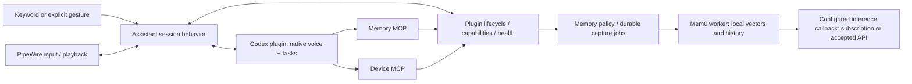

# Personal Agent architecture

Personal Agent is a modular Python application for a reactive personal assistant. A single asyncio host coordinates trusted local plugins. Codex supplies the current reasoning, task and native voice implementation. Devices and local long-term memory remain replaceable. “嘟嘟” is a wake-word setting; neither it nor DELL is the application identity.

## Boundaries

| Location | Owns | Must not own |
| --- | --- | --- |
| `kernel/` | API v1 contracts, dependency order, handler dispatch, task/resource tracking, event fan-out, generations | Devices, Codex protocols, assistant policy |
| `conversation/` | Durable shared timeline, submission receipts, entrance/output intent | HTTP, device drivers, separate task execution |
| `plugins/web/` | Authenticated chat HTTP/SSE and bundled frontend | Independent AI sessions, physical audio, arbitrary file serving |
| `assistant/` | Wake/continuous dialogue/idle, interruption policy, explicit controls | Provider RPCs, vector search, Bluetooth discovery |
| `mcp/` | Independent memory/device/tasks MCP schemas, typed capability mapping and bounded local IPC | Codex session policy, Mem0/storage, device drivers or a second inventory |
| `plugins/codex/` | Foreground voice/thread, isolated background threads/Goals and maintenance context; provider event routing | Device drivers, long-term memory storage |
| `devices/` | Shared inventory, adapter-owned registration, timestamped state, query/media/control routing, resource leases and operation receipts | Hardware protocol code, conversation activation |
| `plugins/pipewire/` | Stable input/output selection, device observations, optional AEC, bounded playback and cleanup | Conversation or task policy |
| `plugins/airplay/` | Optional RAOP discovery/identity, bounded PCM encoding, receiver session and cleanup | Conversation policy, microphone drivers |
| `plugins/go2rtc/` | Configured gateway stream identity, bounded snapshots/clips and directional pan/tilt, availability and cleanup | USB/network camera protocols, conversation policy, gesture inference or automatic recording |
| `plugins/apple_home/` | Authenticated Apple Home readings, paired HAP refresh bridge, normalization and source freshness | AirPlay playback, model tasks, memory, HomePod account access |
| `plugins/search/` | Configured public web search/fetch adapters, bounded IO/cache and metadata receipts | Execution model policy, agent loops, media acquisition, subscription Search Service |
| `plugins/keyword/` | Local KWS and VAD models | Remote transcription or task dispatch |
| `memory/` | Source/version policy, durable pending jobs, replaceable provider contract | User task execution, custom embeddings or ranking |
| `bootstrap.py` | Explicit selection and capability bindings | Protocol implementation |
| `headless.py` | Hardware-free management/trigger host | Pretending unavailable voice/brain is operational |

A capability request has exactly one handler and a timeout. It returns a result or an error. `Control`, `Trigger`, `MemoryRequest`, `DeviceQuery`, `VideoCapture`, `VideoRecord`, `CameraMotion`, `AudioVolume`, `DeviceOperationQuery`, and `DeviceOperationCancel` are separate typed requests. CLI, explicit local commands and the independent MCP services use the same handlers. The user explicitly authorized preapproval for this project’s existing memory/device operations; the project thread exposes those operations as precise tools on separate `memory` and `device` servers. No global Codex approval configuration is changed. Fact events have a source, timestamp, correlation ID and plugin generation. Each subscriber has a separate bounded queue; overflow drops its oldest event and increments its counter. Events are observations, never a durable task queue.

Audio uses a separate bounded path. Format/rate/time/connection generation are explicit at the Codex output boundary. Existing Chromium WebRTC jitter handling, PCM silence preservation, playback epoch checks and bounded queues remain in the audio adapters. Stop clears the local queue and terminates playback without waiting for Bluetooth reconnection. The native protocol does not expose a per-answer audio ID: same-connection late audio still uses the existing quiet-boundary suppression heuristic. Connection generations cannot eliminate that protocol limitation.

Remote quiet boundaries can release interruption suppression independently of local
VAD activity, which may remain active on TV speech or a release delay. Explicit
manual mute remains authoritative. Existing status exposes output-gate state and
written/discarded PCM byte counts; text/RTP reception alone is not audible delivery.
Empty resampler output is not PCM: it must neither reach the player nor reset
remote-silence accumulation and playback timestamps.

Independent audio acceptance lives entirely in `scripts/audio_check/`. It reuses
existing PCM device registries/providers after verifying the assistant is stopped,
with bounded capture and owned prompt playback. It adds no kernel contract,
management command, audio-loop observer or conversation state. Production wake and
DSP behavior stay unchanged; offline wake detection is not live voice acceptance.

## State and ownership

- `wake_words` selects equivalent phrases supported by the installed FSMN V2 bundle, handled by one KWS stream and one activation path. The keyword plugin owns 80ms batching, bounded native features/CTC history, one ONNX inference thread and checksum validation. Inference runs off the event loop; generation changes invalidate results across sleep/session resets. The inference-only upstream FunASR decoder is vendored with its MIT license, without a Torch/FunASR runtime dependency. Local commands strip any configured leading phrase before parsing.
- Assistant owns standby → connecting → active → reconnecting → standby. Only explicit wake/trigger activates it. Background work never activates voice.
- Optional daily quiet hours belong to assistant policy. Local-time boundaries suppress activation and all voice feedback; maintenance closes voice and clears queued output without canceling background work. Device volume and keyword sensitivity are unchanged, and morning availability does not activate voice.
- `VoiceSession.speech_completed` reports a completed spoken turn, separately from transport readiness and audio drain. Output-only notification success requires both completion and drained non-silent audio; it is still not proof a person heard the output. Native protocol fields remain in the Codex adapter.
- Codex owns foreground task state. SQLite logical task IDs and a logical session → provider-thread mapping keep application records independent of opaque provider IDs. Native voice delegation and explicit Web submissions enter the same provider thread; transcripts are synchronized as context, never dispatched a second time.
- The composition root freezes one `VoiceBinding` from `input_device` / `default_output` at startup. The audio adapter snapshots those device connections and reconnects only those endpoints; saved room state is ignored. Binding changes require configuration plus restart. MCP, dynamic tools, CLI and voice commands cannot select another main input/output.
- PipeWire owns optional `connection.hardware_volume` initialization for ALSA-backed input/output devices. It resolves the physical card from that endpoint, validates and verifies the named mixer control, and applies it before PCM delivery or a new primary speech segment. An omitted setting performs no hardware mixer writes. AEC's virtual sink does not replace the physical target; no kernel, assistant or MCP hardware branch is needed.
- The player owns queue/epoch/mute state. Stop, cancel-task and end-session are distinct operations.
- Memory is not provider chat history and cannot prove an action completed. It is sourced, revisable context.

Disconnect recovery runs as a tracked task, leaving the event consumer available. Unknown task outcomes remain unknown and are reconciled from provider state after restart; no input replay. The critical Codex provider failure restarts the service through systemd. Optional memory failures degrade that capability and retry without stopping capture/playback. Contexts own spawned tasks and async cleanup, and generations reject stale request results/events. Plugins in one process are trusted code, not security sandboxes; native-library crashes remain process-wide failures.

## Shared conversation and Web entrance

Optional `plugins/decisions/` owns bounded semantic support through `DecisionQuery`.
`kernel.decisions.decide` returns an explicit original-workflow fallback when the
plugin/provider is disabled, unavailable, uncertain or past its deadline. The plugin
executes no actions. After explicit external-context consent, owners may adopt a
closed-set recommendation: the assistant supplements unhandled short voice controls,
tasks may select an automatic model profile or skip a clearly unrelated inbox batch,
and independent decisions MCP offers evidence-based choices to main/background agents.
Owners retain authorization, current-state revalidation and execution receipts. Exact
rules and known local controls bypass inference. Native automatic handoff is not a
pre-execution approval boundary; this integration does not claim to intercept it.
`DecisionRequest` exposes local status, paging, manual samples and labels. Optional
shadow mode observes bounded `DecisionSample` publications without affecting work.
The provider reads its own secret without changing child environments; private,
off-loop receipts retain hashes/references, versioned answers, token usage and HTTP
latency, not another copy of conversation/event text. Bounded deadlines, auth suspension,
backoff and no uncertain replay isolate this paid dependency. Usage counts are
informational; the framework imposes no daily or lifetime call-count cap.
One provider-owned HTTP pool retains idle connections for up to 120 seconds. A single
owned, asynchronous startup metadata GET warms that pool after consent/credential
checks and `Runtime.ready`; it performs no inference, does not gate readiness or serialize judgments,
and is cancelled on shutdown. There is no recurring keepwarm. Active fallback retains
a 3-second total deadline, including receipt IO, independently of prewarming.
The global switch defaults on; new instances must explicitly consent before active
context leaves the host. See `plugins/decisions/README.md` for use rules and acceptance.

`conversation/` owns the durable shared timeline, stable message identity, source, ordering, submission receipts and public interaction state. The optional `plugins/web/` is only an authenticated HTTP/SSE adapter and built frontend. It cannot access arbitrary files, launch its own model session, or directly manipulate audio devices. Stop/cancel use the existing control capability. Foreground Codex handles conversational delegation; the optional tasks plugin owns durable background work through an injected executor adapter.

Messages and events are committed together in SQLite. Streaming deltas and final transcription corrections update one message ID without reordering it. Voice message IDs combine the logical session, transport generation and provider turn ID; task IDs use the provider item ID. Event retention is bounded; an expired cursor requests a fresh history snapshot. Slow/disconnected browsers cannot block model or audio processing. Requests carry a UUID and content fingerprint; an uncertain submission remains unknown after restart, never automatically retried. Provider resume reconciles known task items. Old local transcripts are imported as explicitly labeled legacy records, without external re-extraction.

Live native voice and task inference have distinct context windows even on one provider thread. The conversation owner explicitly transfers confirmed voice messages through the provider's context-only import method, and Web messages/results through its live context adapter. A local playback gate enforces silent Web replies because the experimental native interface may generate audio even for assistant-role context updates. Physical voice user turns restore playback. Background task delivery is client-managed so Web tasks do not acquire automatic spoken results. Temporary sync failures are visible; context sync never invokes another task.

Foreground results are turn-owned receipts, never shared mutable progress. Empty or
commentary-only completion cannot reuse a previous answer. Conversation durably binds
output to an execution, voice epoch and input revision; old/superseded/quiet/interrupted
results stay in history. Eligible final prose enters the provider's speech append once,
without another prompt to infer a result. Output acceptance is not proof of playout;
lost acknowledgements remain unknown. Native delegation filler and speculative output
while awaiting execution are suppressed. Native client-managed handoff controls result
forwarding, not pre-execution approval; WebRTC audio has no reliable per-answer identity.

Execution acceptance and completion have separate spoken receipts. Normalized provider
`execution_input` acceptance schedules a short delayed acknowledgement; web commentary
never triggers speech. A fast result consumes the pending acknowledgement. Accepted
follow-ups renew output ownership with durable input deduplication; stale speech and
unknown submissions are not replayed. Native rendering still has no per-answer playout
receipt and can paraphrase appended speech.

The optional voice-first command entrance lives in `interaction/`; provider-neutral
contracts live in `kernel/speech.py`, and local inference adapters in `plugins/speech/`.
Capture and inference have separate bounded work paths. The coordinator owns request
versions, recent operation context and feedback; commands reuse isolated durable task
execution and its existing MCP/model policy. Dialogue gets the original utterance once.
The local output scheduler shares the fixed player and arbitrates literal speech with
native output, expiry, interruption and durable delivery states. Command follow-up is
3 seconds; existing native attention remains independently configured. Defaults remain
native until acoustic and latency acceptance passes. See
[voice-first design and measured gates](src/assistant_runtime/interaction/README.md).

Assistant attention defaults to a short request with an 8-second follow-up window after
the reply. Explicit chat selects continuous mode for one activation. Accepted user input,
reply completion and actual output drive deadlines; raw VAD cannot hold the session open.
Local explicit exits invalidate output and close the connection without canceling durable
background tasks. Directed-speech admission and verified device takeover remain separate
boundaries, not implied by a voice transcript. See `plugins/codex/README.md` for protocol
limits and explicit subscription/device acceptance.

Requested capture replies register complete pixels with the conversation media owner before crossing the provider boundary; the device MCP passes generic attachment references alongside native image content. This avoids relying on the provider's truncated display/history bytes. Reply image content and references are translated inside the Codex adapter, including JSON-wrapped MCP results in resumed history. The conversation owner uses an owned bounded queue and off-loop image decoding to register private attachments in the same media store as uploads; original image bytes never enter SSE or transcript text. Stable per-message/content identities prevent duplicate assets on replay. Restoration using registered references or retained complete bytes can fill an existing message's missing attachment without a new capture/task or changing its position/time. The UI displays media outside collapsed tool details. Only explicit image content is accepted: model text cannot turn arbitrary filesystem paths or external URLs into served files. With Web disabled, this path does not begin storing camera images.

The Web listener defaults to loopback and requires a randomly generated local credential. HttpOnly same-site sessions are stored hashed, with expiration and credential-rotation invalidation. Mutations require same-origin requests; numeric hosts/localhost prevent arbitrary-domain DNS rebinding. Images are decoded, bounded, metadata-stripped and stored privately; authenticated routes serve only known image IDs. There is no public model endpoint, static workspace access, browser microphone, or external asset dependency. HTTP deployments are for trusted LAN/VPN/tunnels; the separate report server must deny private state and configuration paths.

Background captures retain up to four deduplicated registered media references per
run, pinned independently of notification settings. Task queries project the selected
page's newest run attachments at the top level for conversation delivery and keep
each run's own references for task details. Historical task replies can restore those
references without recapturing; an empty newer run never borrows older media. Both
views use the same authenticated media component and a native modal image preview
above mobile drawers. Text and arbitrary paths never become media capabilities.

Task and notification views share one persistent native dialog. On desktop it is a
nonmodal side panel; the original composer shortcuts remain clickable and switch the
view directly. The panel ends above those shortcuts; outside pointer interaction closes
it without consuming the click. On small screens it is modal, with background scroll
locked until close completes. Headers show the active title and its actions, not a second
navigation. Filters/detail/scroll survive switching. One owner animates the surface and
scrim through the browser Web Animations API; interrupted transitions resume from the
current frame and reduced-motion bypasses animation. Views poll only while active.

## MCP service boundary

Explicit video recording uses `VideoRecord` → the registered video provider → a
completed private `VideoClip`. Gateway encoding is on demand and reuses configured
sources; host FFmpeg is limited to finalizing and validating the completed local
file. Duration, size, generation and resource cleanup are bounded. The conversation
media owner adopts only validated files from its recording staging directory and
returns registered attachment references. Raw clip bytes and arbitrary file paths
do not enter MCP, SSE or model context. `record_video` is a mutating device tool,
and Web serves known video IDs through its existing authenticated attachment route,
including seek ranges. Video-only output is shown live and survives history reload.
Image uploads remain image-only; no continuous recorder or video-analysis API is added.

`mcp/memory.py` exposes `search_memory`, `read_memory`, `remember_memory`, `update_memory`, and `forget_memory`. `mcp/device.py` exposes device discovery/inspection, explicit image/video capture, camera motion, device-targeted volume, operation queries/cancellation and the existing interaction controls. Individual operations have typed arguments and read/write annotations; there is no overloaded arbitrary `action` tool. Remember creates a new fact; update requires the existing ID, current revision and original scope. Forget retains its established tombstone semantics.

Each server is an independent stdio entry point (`python -m assistant_runtime.mcp memory|device --socket PATH`). Both use the same Python environment and host capability socket. They are provider-neutral and can be connected by an MCP client independently of Codex. The former combined Codex `tools.py` facade is removed. `plugins/codex/mcp.py` only supplies project-thread server registration/tool allowlists; maintenance threads disable both servers. Existing local-operation preapproval is retained within this project and does not authorize additional/global tools.

The MCP layer translates between tool schemas/results and the corresponding typed kernel capability requests. The bounded shared transport has a timeout, propagates failures and does not retry uncertain actions. Memory policy and Mem0 remain under `memory/`. Hardware state and capabilities come from `devices/`; protocol drivers remain in device plugins. MCP never opens hardware, reads memory databases, pairs Bluetooth, or maintains a duplicate registry. Task management is exposed by independent tasks MCP and TaskRequest capabilities; it does not activate microphone capture. Interaction-control tools delegate to the assistant owner and do not execute tasks themselves.

`list_devices` reads the live registered directory on every call; `inspect_device` uses that directory's probe routing. A device added through the established onboarding workflow therefore appears with its capabilities and fresh readings without a new MCP schema or hardware-specific branch. A new action such as a thermostat setpoint still requires its own typed capability, narrow tool and approval decision; a new device declaration cannot grant an arbitrary command executor. Unit and isolated real-MCP acceptance both test a sensor registered after the MCP connection was established.

## Third-party MCP management

`plugins/integrations/` owns the atomic revisioned `.agents/mcp/servers.json` registry,
policy validation, management capability and verification receipts. Non-secret definitions
are versioned in Git; package files, receipts and runtime directories stay in ignored
`state/`. Credentials use host environment references or the native credential store,
never literal secrets in the registry. `IntegrationProvider` is the reasoning
adapter seam; Codex MCP field mapping, native discovery, authentication and thread refresh
remain in `plugins/codex/integrations.py`. The independent `integrations` MCP and CLI
share `IntegrationRequest`; they do not implement a second external-tool proxy.

Definitions have explicit foreground/background scopes, tool filtering and approval,
bounded startup/call timeouts, stable per-server cwd and private credential references.
User/project MCP inheritance is explicit; each context reads its effective config so
unknown user/project servers can be disabled, including after a cwd change. Memory
maintenance and validation contexts always disable inherited and internal tools.
Background executions retain their dispatch snapshot and `mcp_revision`; the shared
registry cannot mutate tools during a run. Authorized installation runs use the existing
`mcp_management` resource, checked against an active execution and inherited by children
only within their parent's resource scope. Other jobs get only management queries/probes.

The foreground waits for idle model and native voice, releases its subscription and
resumes the same persisted thread with the new MCP configuration. It never restarts the
assistant or replays a turn. Native voice start shares its dispatch lock; closing voice
stays active through teardown. Failed refresh restores the previous confirmed config
and requires a correction or explicit retry of the failed revision. Discovery uses owned
ephemeral contexts, checks real tools/auth, bounds concurrency and cleans up even after
cancellation or a late startup acknowledgement. It is distinct from applying configuration
or testing a real tool action. External descriptions and metadata remain data, not
instructions. These endpoints do not replace main voice or implicitly acquire framework
device leases. See the [integration guide](src/assistant_runtime/plugins/integrations/README.md).

## Long-term memory

The default backend is Mem0 1.0.11, using its original ADD/UPDATE/DELETE/NONE workflow. Version 2.2.1 uses additive automatic ingestion and was not selected for this application’s correction/merge contract. A trusted worker in the **same `.venv`** owns one embedded local Qdrant store and Mem0’s SQLite history. Telemetry and remote provider defaults are disabled. A thin FastEmbed provider uses the existing multilingual MiniLM model, 384 dimensions, two threads and an explicit local-only cache under `models/memory-embedding/`.

The worker's registered LLM provider sends a bounded internal callback to the host. By default the host submits a silent, tool-free, ephemeral JSON task to the official Codex App Server over stdio and checks the ChatGPT login. With an explicitly accepted `model_api.memory` binding it invokes the models capability instead; source validation and Mem0 ownership are unchanged. This is application-internal IPC, not an OpenAI-compatible HTTP server, credential exporter or public model service. Memory inference uses independent project `memory_model` / `memory_reasoning_effort` settings, separate from foreground task settings; neither path automatically falls back to the other. Calls are serialized. Failed automatic jobs have bounded retries with exponential backoff and foreground wake preempts work.

Mem0 owns fact extraction, related-memory retrieval, deduplication and change decisions. Application policy supplies scope/persistence instructions and validates that each proposed fact has an exact quote from an actual user transcript. Assistant responses and provider-reported task completion are excluded from automatic evidence. Explicit remember/correct/forget remains an authorized capability; a current revision is required when correcting a record, and scope cannot silently change. These provenance checks do not prove semantic truth.

The application keeps logical IDs, revisions and tombstones in host SQLite and portable metadata in Mem0. Native write results are checked by readback. Bounded receipts make completed automatic source batches idempotent across worker restart; uncertain partial writes remain visible for reconciliation rather than being claimed as a completed batch. Canceling an operation closes the owned worker before its lock is released, preventing late canceled writes from racing an explicit correction/forget. A committed native fact whose application metadata attachment was interrupted is recovered from its bounded original source batch.

Forget writes a tombstone before physical deletion; reads, recall and export exclude it even if deletion fails. Old jobs/imports cannot revive its logical ID, and cleanup retries deletions. Foreground wake context still uses at most eight cached facts, without waiting for embedding/model startup. User and per-workspace project namespaces are isolated by upstream entity filters. The provider contract retains search/read/upsert/delete/export/import and adds automatic capture. Export moves facts/provenance, not embeddings; another backend must rebuild its index.

One-off migration is performed from a private backup: explicit records are retained; automatic records are copied locally only when their original user evidence is verified. Historical content is not sent to the model for re-extraction. Legacy model reports are kept in the backup, not promoted to verified facts. Old code and its dependency are removed after verification; no parallel Basic Memory index or compatibility layer is used at runtime.

## Extension and deployment

Bundled adapters are explicit entries in the composition root; configured capability bindings choose their owners. Trusted local factories may be registered with `local_plugins.name="package.module:factory"`, enabled in `plugins`, and selected in `bindings`; the factory receives the composition context (service). New trusted plugins use a manifest/API version, lifecycle context, handlers and/or fact events. The simulated `wave` gesture exercises the same `Trigger` request as future camera perception; gesture inference is not installed; explicit camera capture is provided by the optional go2rtc adapter.

The default execution model remains one Python environment, one asyncio host and managed child processes. No container, plugin marketplace, hot reload, message broker, or management website is required. The installer only renders/enables a user unit. Host Bluetooth codec settings are optional deployment-profile material, never applied by generic installation. Root/workspace/model paths and stable device identities live in instance TOML; headless management and kernel tests need no audio hardware or models.

## Hardware onboarding standard

Use this procedure for every new hardware input/output. The shared `DeviceDirectory`/`DevicesPlugin` now registers configured devices, routes read-only `DeviceQuery(list/inspect)` to adapter probes, and reports bounded, timestamped `DeviceObservation` snapshots. The existing microphone and Bluetooth speakers use this path. Protocol discovery, actuator operations and new media transports remain adapter-specific; a configuration declaration alone cannot supply an absent driver.

### One integration package

Keep one adapter per protocol/device family under `plugins/<family>/`. Use separate instances/config entries for physical devices of the same family; do not duplicate the driver for each room. Each integration supplies:

- A short README identifying supported models, protocol, system prerequisites, configuration, supported capabilities and known limits.
- A plugin manifest/factory and lifecycle implementation. Use `context.spawn` for owned background work and `context.own` for cleanup; construction must not connect or pair hardware.
- The protocol adapter, including data decoding, availability and reconnection. Prefer maintained protocol libraries over custom Bluetooth/AirPlay implementations.
- Contract tests with a fake transport and a separate explicit real-device acceptance entry point. Private evidence goes under `state/acceptance/<integration>/`.
- An example configuration containing placeholders. Local addresses, pairing credentials and real readings stay outside Git.

Use stable logical IDs such as `living_temperature` and `living_homepod` in assistant requests. Bluetooth addresses, USB serials and network addresses belong to the adapter's instance configuration. A device label/room is editable and is not its identity. Never identify a device by a transient enumeration number.

### Three paths, with different semantics

| Device path | Contract | Meaning |
| --- | --- | --- |
| State/commands | Typed capability requests and structured results | Query a sensor or request a device action; caller receives a timeout/error/result |
| Observations | Bounded `Event` stream | Report a new reading or availability change; publishing alone does not notify the model |
| Media | Dedicated bounded media path | Audio/video frames; do not send PCM or video through the generic event bus or memory |

An adapter reports measurements with device ID, metric, value, unit, sample time, reception time and validity/freshness. State distinguishes unavailable, stale and current readings. Historical values may be returned only when explicitly labeled; a missing device must not silently become another device. Keep sensor snapshots separate from long-term memory. Persist history only when an actual feature requires it, with retention defined for that feature.

Each logical endpoint has exactly one adapter owner. Optional `physical_id` associates multiple endpoints of one piece of hardware without merging their owners or availability: HomePod playback uses AirPlay while its sensor endpoint uses Apple Home; a USB camera can have separate video/audio endpoints. An endpoint without an explicit association uses its logical ID. A sibling being online does not establish measurement availability.

The stdlib-only `SensorReading` contract carries one metric's numeric value, unit, source, sample timestamp and validity. Adapter decoding/validation produces this contract; the directory checks declared metric capabilities and serializes it under `readings`. Every metric has independent age/freshness. Unchanged heartbeats cannot reset its monotonic ageing. Unavailable/calibrating metrics have no current numeric value; a retained expired reading is marked stale. Configuration controls the freshness limit. Neither device discovery nor MCP maintains a second sensor registry.

The optional Apple Home adapter uses upstream HAP-python for a paired virtual Lightbulb refresh trigger and a bounded authenticated HTTP route for Home automation readback. Source timestamp/order validation happens before atomic replacement of the latest private SQLite snapshot. Refresh is bounded, coalesced and optional; failure degrades the source, not another endpoint or the assistant. Pairing/accessory identities persist across restart and later additions. Apple-side automation must be configured once against real Home/accessories; synthetic HTTP/MCP acceptance does not prove real HomePod acquisition. Measurements publish metadata observations without activating voice, task dispatch or long-term memory. CLI and existing device MCP queries reuse the directory; no HomePod-specific model tool is introduced.

The device inventory marks `voice_role=input|output|null` and `voice_binding_locked`.
Binding fixes the conversation route, not exclusive ownership of that physical endpoint:
a tool may target either a main or additional device by its explicit logical ID.
`capabilities` describes hardware; `tool_operations` lists registered executable actions,
and `media_streams` describes the implemented stream providers and sharing policy.
A descriptor does not imply an unimplemented microphone, speaker or video-output tool.

`host.audio_inputs` / `host.audio_outputs` own independent PCM transports and resource
leases for both main voice and tool consumers. An adapter registers an AudioInputProvider
or AudioOutputProvider and explicitly declares whether streams may share the endpoint.
The default is exclusive: a busy resource returns an error without closing, moving or
replacing its owner. PipeWire declares independent capture streams/mixed playback;
AirPlay remains exclusive per receiver. Closing a stream affects only that stream;
a lease is released after successful transport cleanup. Failed cleanup retains the lease.
Related sensor/speaker/camera endpoints may share `physical_id` without implying the
same resource; the adapter must declare actual contention. Raw provider access is for
inspection/volume only; stream acquisition always goes through the registry.

Audio input is bounded mono PCM16 data for its explicit consumer, not a conversation
turn, wake trigger, instruction or automatic memory. New tool-side recording/playback
requires its own typed request, bounded handler and narrow MCP schema. It must not borrow
the voice player/capture, activate voice, select a route or use a fallback device.
This framework supplies the ownership path; it adds no speech synthesis, transcription,
music source or room-specific listening feature. External voice output may mirror its
own PCM into the existing AEC reference bus without playing through another speaker.
Accepting PCM proves submission, not audible physical playback.

`DeviceOperations` coordinates existing snapshot, recording, camera motion and volume
handlers through explicit operation IDs. Resources are per logical endpoint and named
function, so an unrelated operation does not block another device. Camera stop remains
available while motion is busy; the adapter owns the physical stop and its cleanup.
Operation workers and cleanup belong to the devices plugin lifecycle. MCP can query or
cancel one operation without canceling main voice or other work. Caller disconnect and
timeout cancel that operation and wait for adapter cleanup; cancellation does not undo
already delivered physical effects. Mutating failures may have an unknown outcome.
SQLite retains identity/state/timing receipts across restart, while in-memory completed
metadata and list queries are bounded. Receipts contain no PCM, images, credentials or
request text. A restarted running operation becomes unknown and is never replayed;
reusing an ID requires querying its receipt, never executing it again.

`set_audio_volume(device_id, percent)` targets that registered speaker without changing
the binding. A response with `applied=false, scope=next_stream` is only a saved preference.
`stop_playback` and `end_voice_conversation` remain explicit controls of the main session.

A video input implements VideoInputProvider and registers through host.video_inputs. One shared devices owner routes VideoCapture by logical ID and returns a bounded, generation-aware VideoFrame. The go2rtc adapter requests uncached snapshots only on explicit input; its metadata observer never opens a video consumer. The separately managed gateway owns USB V4L2, RTSP and other camera protocols, formats and optional transcoding. The assistant neither opens video nodes nor launches camera FFmpeg processes. Gateway reachability and stream registration are distinct from successful acquisition; `capture_verified` describes a successful frame in the current observed source generation. Source changes or observed outages invalidate that generation, and failed requests never return earlier pixels. CLI can explicitly save a JPEG; Codex receives native MCP image content through device MCP capture_image. Only capture metadata enters events, never pixels or automatic memory. Future video streaming/gesture detection requires an explicit media consumer and trigger policy.

### Capability ownership and AI access

Directional camera actuation uses the typed `CameraMotion` request and the shared
`CameraControls` registry, separate from media acquisition and assistant voice
controls. Only explicitly configured, physically verified movable endpoints
declare `camera.pan_tilt`; fixed lenses retain snapshot/recording capabilities without motor control. The go2rtc adapter
owns bounded active-session acquisition, short motor requests, stop/cancellation
and cleanup. No movement is retried on uncertain outcomes, and command delivery
does not imply measured position. The MCP `move_camera` and `stop_camera` tools
translate requests without camera protocol code. Directions, duration limits and
lack of angle feedback are discoverable through the existing device directory.

Define a concrete request contract in `kernel/contracts.py` only when the first integration needs it. Keep protocol-specific fields in the adapter. The current runtime permits one handler per request type: when multiple sensor/device plugins implement the same ability, a single capability owner routes by logical device ID to the matching adapter. Individual physical devices must not each register the same request type. Do not create a universal arbitrary-method execution tool.

The shared directory contains enabled logical IDs, labels/locations, declared capabilities and freshness-aware availability. Every adapter registers devices during start and updates observations in owned background work. One directory plugin owns the query request type and validates that all enabled configuration entries were registered. A future state sensor can reuse list/inspect without changing the directory or adding another handler.

Expose narrowly defined tools through the local capability facade; CLI and Codex use the same handlers and result semantics. The service request dispatcher must route those new requests to the capability owner. Current `device` list/inspect tools automatically expose registered descriptors and non-media state. Device volume uses `AudioVolume`; main-session interruption stays on its explicit control route. Add only additional tool schemas required by a new action; read and mutating actions have distinct descriptions/approval semantics, and existing tool authorization is not implicitly widened.

Provide enabled-device descriptions at voice-session startup so the voice layer can delegate appropriate queries/actions to Codex. The model reads actual state through tools rather than guessing from a description. Measurements and external-device labels are data, not instructions. Do not copy arbitrary BLE payloads into system/developer prompts.

Events update local state by default. Only an explicitly configured trigger calls `Trigger`; passive temperature updates do not wake the assistant. A future alert rule separately defines conditions, freshness, debounce/cooldown, action and whether standby may be interrupted. Do not forward every high-frequency sample to the model.

### Configuration and host integration

Local plugin factories are registered through `local_plugins`, enabled in `plugins`, and selected by the relevant `bindings`. The factory receives the host, including its shared device directory. Every physical device is configured under `devices.<logical_id>` with adapter/kind/label/location, optional enabled/max_age_seconds and an adapter-owned connection table. The strict Config loader validates common metadata, adapter enablement, device count and voice selection; each adapter validates its connection schema before touching hardware. There are no old source_match/speakers/room_labels configuration aliases.

Adding a new device from an already supported family should then require instance configuration only. Adding a new protocol requires an adapter; adding a new category of ability may also require a capability contract/tool/host binding once. Hardware identities and operating-system paths must remain configurable for Linux hosts. Generic installation must not modify Bluetooth ownership, audio codecs or global permissions.

### Repeatable acceptance

An integration is complete only when its README includes results for:

1. Valid/invalid configuration, stable logical identity and supported-device/protocol checks.
2. Real data/action and independent physical confirmation where applicable (known temperature comparison, audible playback, or the target actuator's actual state).
3. Caller-visible device-not-found, malformed data, permission denial, timeout and stale-reading behavior.
4. Disconnection/reconnection without duplicate actions, stale generations or silent device substitution. Retry read operations; do not replay actions with uncertain outcomes.
5. Service restart recovery and cleanup, bounded queues/state, and CPU/memory measurements appropriate to a continuously running device.
6. The actual AI tool path, including selecting the intended device and reporting true errors. A fake driver test alone does not establish this.
7. Coexistence with voice capture/playback and standby privacy. Passive sensor input must not activate a conversation; only the configured explicit trigger may do so.

For a BLE temperature sensor the first implementation includes protocol identification, one sensor adapter, connection validation, freshness-aware observations and real-device acceptance. It reuses the installed directory/read capability and read-only tool. For a second sensor using that same protocol, reuse all of those pieces and add its instance configuration. Commit source/config examples/tests; retain readings, recordings, logs and pairing data in ignored instance storage.

## Evolution rules

Add concrete capabilities when an extension needs them; do not expand a universal event object into a second RPC system. Keep media work bounded and expensive memory work out of the audio process. Preserve task and memory state during code rollback. Tests belong beside the behavior they protect, and one check command runs formatting, static checks and unit contracts. No compatibility package or old CLI is shipped during development.

## Durable background work

`plugins/tasks/` owns definitions, trigger evaluation, run snapshots, resource slots and
stable result cards. The composition root injects the Codex executor; no Codex RPC fields
belong in kernel contracts or task MCP. The provider routes background events before
foreground/voice handling, so steering and questions cannot contaminate the main turn.
APScheduler supplies calendars; SQLite owns persisted occurrence IDs and schedule cursors.
Immediate non-Goal one-shot delegations are temporary; scheduled/event/Goal work is
planned. One-shots automatically archive after any terminal outcome by default, while
retaining results/outbox delivery. This organizational transition never cancels work;
parents wait for unfinished descendants. Startup applies the same policy to existing
ended tasks. Archived records remain queryable but cannot resume execution.
Each model execution starts with its registered run `scratch/` as provider cwd;
the authorized target project remains explicit task context, and results go to its
own `artifacts/`. Existing sandbox/approval settings remain instance-owned.
Provider thread cleanup is separate from task-definition archival. A durable per-run,
per-continuation receipt queues confirmed terminal executions for the executor's
finalize method, including existing ended runs on startup. The lifecycle-owned cleanup
worker checks provider status, latest-turn summary and live commands before archiving,
unsubscribes and releases handles. Failures back off without rerunning work, blocking
notifications, changing results/timing or consuming notification revisions. Active,
waiting, paused and uncertain runs are retained. Explicit continuation serializes with
cleanup and restores an archived provider thread before resume. Foreground threads
are excluded; provider RPCs and archive-path semantics stay in the Codex adapter.
Task browsing uses SQLite keyset pages ordered by creation time and stable ID, with
server-side category/search filters and indexed per-task run history. Web has temporary
work first (unfinished non-archived by default, optional include-archived) and plans
(non-archived by default, optional include-archived). The MCP active-only filter selects enabled definitions with future
triggers, event listening or unfinished runs; paused/archived/terminated definitions
and ended one-shots are inactive. Filter values are part of each cursor's scope. Web and MCP share
the same bounded page contract (20 by default, at most 50). List rows contain bounded
latest/unfinished summaries; full results are fetched only for the selected task.
Web loads older tasks and expanded run history on scroll, polls only one bounded head
page plus bounded known unfinished tasks/runs, and aborts obsolete queries on navigation. Cached
older pages do not multiply polling requests. Closed/hidden views do not poll.
No uncertain action is automatically replayed. A Goal's completion differs from an
ordinary turn completing; external processes require their own checkpoints and identity.
An actual native Goal created during a one-shot also retains that run's existing
authority across intermediate turns. It does not expand scope or create a new task.
Completion waits for the Goal and final turn; cancellation pauses the actual Goal,
late continuation cannot reactivate ended work, and restart never replays it.

`tasks` MCP is independent of memory/device. CLI and authenticated Web share TaskRequest;
existing foreground cancellation controls remain distinct. Task models resolve from the
account catalog at creation according to fixed configuration or initiating-agent choice.
Tasks owns one versioned model policy with configurable fast/balanced/deep/ultra profiles.
`ultra` is reserved for exceptional reasoning/original research with justification that
`deep` is insufficient; routine research search/summaries do not qualify. Instance
defaults remain fast with one controlled upgrade, and profile mappings remain configurable.
`ultra` defaults to Astra/high. Tasks forms bounded account-supported profile/effort
combinations for a single optional Jev judgment, filling only unresolved fields; fixed
values and explicit fields filter the supported candidates. That one HTTP request
batches separate small tier/effort questions; each field requires its own confidence
threshold, and the final combination still passes executor validation. No joint
probability is fabricated from independent answers. Fixed
instance values and explicit agent fields win independently. Canonical combination IDs
select trusted candidates rather than generated model arguments. Single-option cases
stay local, and failed advice returns to the original profile defaults. Reasoning effort
can vary without losing tier identity; selection receipts record origins of both fields.
Missing/auto choices resolve through that policy instead of inheriting main/parent models;
explicit agent choices require reasoning grounded in uncertainty and acceptance checks.
The executor validates concrete account support and reports provider-confirmed selections.
Per-run segment receipts retain selection provenance and bounded upgrade history.
An owned handoff worker accepts scoped, budgeted upgrade requests with checkpoints,
waits for clean turn completion and executor proof of idle thread/no live commands, then
continues the same independent thread without replaying effects or publishing an interim
completion. Ambiguous dispatch stays unknown. Native Goals and custom/fixed selections
remain under explicit task management. No extra routing model or automation plugin is used.
User-authorized goals may derive scoped children, not new unapproved goals. Memory is
shared through the existing provider and scope/source policy, never used as execution proof.

`tasks/self_schedule.py` owns explicitly granted self scheduling. Foreground management
records a condition and exact allowed timed triggers; an active background caller can
change only its own future schedule through a dedicated capability. The run snapshot,
current grant, revision and database compare-and-swap must agree. User edits/pause/end
invalidate older execution authority. Definition and UUID receipt commit atomically;
lost replies never cause a second change or restart the current work. Trace exposes
bounded receipts; condition evidence remains executor-reported, not proof of completion.
General task mutation, scope expansion and granting capabilities to children stay denied.
Explicit `self_completion` uses the same identity/version/audit boundary to archive future
scheduling while preserving the current run for final reporting. Domain completion
evidence remains executor-reported; no implicit permission follows from finishing a turn.

Durable record subscriptions are another tasks trigger, not a separate automation
engine. `tasks/event_inbox.py` consumes EventRequest changes and commits cursor, bounded
pending references, decisions and automatic run creation in one host SQLite transaction.
New subscriptions/edits/resumes start at the current tail. Baselines/manual revisions do
not trigger work; pending/queued facts are invalidated or expired before dispatch. Merge,
cooldown and single active execution bound AI work; overflow and uncertainty are visible.
Existing device-threshold and task-completion triggers remain separate supported modes.
Task trace associates event references, immutable run snapshots and provider tool metadata;
it does not copy raw event/tool payloads or assert exactly-once physical effects.
Provider-specific tool parsing stays in Codex; tasks MCP/CLI own inbox/trace queries.

`workfiles.py` is application-wide directory ownership and retention. It registers private
scratch/artifact areas for main conversations and each task run. Only ended scratch areas
expire; no repository traversal cleanup. Artifacts are downloadable via authenticated
registered-run routes. Media still uses the existing bounded attachment owner.

## Media acquisition

The optional `plugins/media/` owns public-share acquisition and independent media MCP/CLI.
It reuses tasks for tracking plans, notifications for delivery and the standard event
reporter for observations. PanSou, Aliyun and OpenList remain separate adapters; the
kernel only adds `MediaRequest`. Provider auth runs in bounded owned SDK subprocesses;
one credential lease/lock owns refresh and atomic replacement. Credentials stay private,
never in MCP, event records, config examples or shared Codex settings. Host SQLite owns
operation IDs, intent snapshots, hash/size verification and the durable notice outbox.
Original-file downloads use a separate owned worker with bounded HTTP streaming and
off-loop disk IO. A required mounted filesystem, private staging outside the published
library and atomic no-clobber publication prevent accidental SSD writes or incomplete
playable entries. Complete checksum validation precedes local completion; signed URLs
are short-lived internal capabilities and never enter receipts/MCP. Copy and download
have separate operation identities, recovery and completion evidence.
Submitted/unknown writes reconcile on restart instead of replay. Background writes
require an active task and its explicit `media:TARGET` resource; interactive login stays
in the main conversation. Cloud completion, OpenList availability and physical playback
are different evidence. See the [media plugin](src/assistant_runtime/plugins/media/README.md).

Public discovery also stays in media: bounded explicit title/alias fan-out through
PanSou, platform/share identity normalization, immutable pages, durable bounded search
summaries and short-lived exact-scope share observations. Discovery capability is
separate from acquisition. PanSou owns its source adapters and scraping; per-query
completion is unknown where upstream supplies no receipt. Recent source health cannot
be presented as query completion or global absence. No model routing policy changes
or additional search/agent loop accompany these capabilities.

Media library management remains inside that plugin: stable provider IDs and separate
last-observed locations, revisioned collection criteria, bounded preconditioned change
plans, and durable batches over existing operation workers. Aliyun owns cloud writes;
local management uses mounted, same-volume, no-follow filesystem operations and private
trash. Unknown writes reconcile without replay; cancellation preserves completed steps.
Batch notification aggregation does not create another scheduler. Tasks own periodic
checks and controlled plan completion; cloud save, organized placement, local checksum,
OpenList visibility and actual playback stay separate evidence.

## Durable notifications

`plugins/notifications/` owns the stable inbox, producer-scoped event identity, revisions,
revision-aware read/unread state and per-channel delivery receipts. Notifications have
no archive state; corrections become unread again. `NotificationRequest` is the common
capability used by independent notifications MCP, CLI and Web. Task identity is derived
from its run, not accepted from generated content. Publishing commits notification and
outbox before acknowledgement; task completion marks delivery queued only after publish.
The kernel's bounded lossy event bus is not a notification store.

Adapters own transport work, retry safety and delivery receipts. Chat uses stable IDs;
Codex context and audio expose uncertain outcomes rather than replaying non-idempotent
side effects. Policies apply at delivery, including idle/quiet periods and expiry. No
worker blocks the main conversation; no notification enables remote microphone input.
Read acknowledgements are user actions and independent of channel success. The inbox
survives provider session replacement. Selected notification evidence joins a follow-up
as quoted data, never as privileged instructions. Mobile push remains an adapter seam.

Notification execution metadata is a read projection through `TaskRequest`, with execution
lookups batched per inbox page. Task event publication and automatic completion notices
are distinct. Timing becoming available does not create a content correction, reset read
state or replay chat/context/voice deliveries. Web refreshes pending execution metadata
without replacing paginated inbox contents.

## Durable event observations

The optional `events` plugin owns only independent SQLite records, validation, bounded
admission, deduplication, revisions/tombstones, quota and queries. It never owns device
protocols, credentials or polling. `Context.event_reporter` supplies a source-bound
kernel contract: `report` confirms durable commit, `offer` confirms bounded admission
only. Advanced producers may atomically checkpoint observations and declare gaps.
Failure is explicit and cannot block the real-time audio path. The kernel imports no
plugin; its lossy event bus carries only committed-update/capacity hints.

`plugins/observations` manages revisioned source configuration and lifecycle through
`ObservationRequest`. Injected producers choose business hooks, subscriptions or their
own bounded polling. Wake business facts remain assistant-owned; Reyee and television
protocols/comparison state live under their own plugin families. There is no global
hardware polling loop or blanket AOP instrumentation. Source changes stop/drain only
the target instance, preserving identity/history and observation gaps.

The independent events MCP/CLI is a facade: `EventRequest` owns record CRUD/query, source
management forwards to `ObservationRequest`. Main and background use the shared MCP
catalogue and authorization rules. Source definitions live in tracked
`.agents/observations/sources.json`; credentials in private `state/observations/`;
records remain in `state/events/`. Recording itself starts no model, notification or
memory work; explicitly configured task subscriptions consume committed observations. See [recording contracts](src/assistant_runtime/plugins/events/README.md)
and [source onboarding](src/assistant_runtime/plugins/observations/README.md).

Notification associations are independent of producer ownership and event deduplication.
The notifications plugin owns source-scoped group identity, stable group/member pagination
and snapshot-bounded acknowledgements. Task execution defaults and explicit topic keys
are evidence-based; no title/time similarity or business-completion inference is used.
Trusted producer adapters may enrich legacy associations through internal `NotificationLink`,
never exposed as caller-supplied IPC/MCP authority. Media carries its stored execution
origin through its outbox and restores only its own historical operation links. Original
content, revisions and delivery receipts are not rewritten or replayed by grouping.

## Optional public web search

`SearchRequest` is the shared internal/MCP/CLI contract. The optional search plugin owns
DeepSeek Search/Fetch protocol, public-page validation, reusable HTTP connections,
bounded admission, deadlines, one transient retry, coalescing and ephemeral content cache.
Only bounded call metadata is persisted. MCP binds the active task identity server-side;
main and background/API executors use the same service catalogue. Configuration belongs
to `config/search.toml`, with credential environment references, effective after restart.
Configured does not mean remotely verified; capability inspection makes no paid request.

Subscription Search Service remains a parallel independent tool. Neither tool changes
the execution model or silently falls back to the other. Media acquisition remains in
media; no search agent loop, browser or local crawler is introduced. Third-party page
content is untrusted evidence, never authority. DeepSeek does not expose its final
redirect URL; adapter output explicitly leaves it unknown rather than asserting that
upstream redirects have been locally verified. See [search](src/assistant_runtime/plugins/search/README.md)
for caller contracts, limits, failure semantics and explicit real-provider acceptance.

## Optional API models

Instance TOML is composed once by `Config.load()`: one entry explicitly includes up
to 32 relative files inside its directory. Fragments cannot include other files;
disjoint table keys merge, duplicate leaves or table/value conflicts fail with source
paths. Plugins receive the same normalized `Config`, never read fragments themselves.
Missing explicit files fail; only absent implicit XDG configuration permits the existing
headless default. Relative instance `root` resolves against the entry directory, so
moving configuration must explicitly preserve data, credentials and audio bindings.

`plugins/models` owns bounded no-tool inference through `kernel/models.ModelRequest`,
private durable UUID receipts and an independent MCP. Official endpoint presets and
explicit custom endpoints normalize from `model_api`; generated gateway files are
private derivatives. LiteLLM runs in a pinned independent container and owns protocol
conversion only. It has no MCP, task or device authority.

API reasoning levels and defaults belong to each model entry. The same declaration
feeds auxiliary MCP, native execution metadata, task advice and gateway validation.
Explicit effort is preserved across inference fallbacks; incompatible candidates are
skipped rather than downgraded. Auxiliary and execution output budgets are independent
and include reasoning tokens. Protocol mapping stays in the gateway adapter.

The composition root injects `RoutedJobs` when API support is enabled. It reuses
`CodexJobs`, with separate subscription and API app-server processes. Subscription
voice/main execution remain on their original process. Tasks owns model selection,
permissions and checkpoints; changing provider creates a fresh execution thread after
confirmed safe handoff. Explicit ordered fallbacks are owned by models (no-tool calls) and tasks (execution), never by the gateway. Native rejection plus a complete readback proving no actions permits a fresh first-turn execution; uncertain operations, prior turns and Goals are never replayed. Attempts, errors and the selected model are durable and logged.
Mem0 extraction can bind to the no-tool API capability, retaining its source policy
and local embeddings. See [model access](src/assistant_runtime/plugins/models/README.md)
for configuration, limits, deployment and acceptance boundaries.
