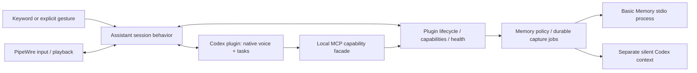

# Personal Agent architecture

Personal Agent is a modular Python application for a reactive personal assistant. A single asyncio host coordinates trusted local plugins. Codex supplies the current reasoning, task and native voice implementation. Devices and local long-term memory remain replaceable. “嘟嘟” is a wake-word setting; neither it nor DELL is the application identity.

## Boundaries

| Location | Owns | Must not own |
| --- | --- | --- |
| `kernel/` | API v1 contracts, dependency order, handler dispatch, task/resource tracking, event fan-out, generations | Devices, Codex protocols, assistant policy |
| `assistant/` | Wake/continuous dialogue/idle, interruption policy, explicit controls | Provider RPCs, vector search, Bluetooth discovery |
| `plugins/codex/` | One foreground provider thread, its voice transport and native task delegation; separate maintenance context | Device drivers, long-term memory storage |
| `plugins/pipewire/` | Stable input/output selection, optional AEC, bounded playback and cleanup | Conversation or task policy |
| `plugins/keyword/` | Local KWS and VAD models | Remote transcription or task dispatch |
| `memory/` | Source/version policy, durable pending jobs, replaceable provider contract | User task execution, custom embeddings or ranking |
| `bootstrap.py` | Explicit selection and capability bindings | Protocol implementation |
| `headless.py` | Hardware-free management/trigger host | Pretending unavailable voice/brain is operational |

A capability request has exactly one handler and a timeout. It returns a result or an error. `Control`, `Trigger`, and `MemoryRequest` are separate typed requests. CLI, explicit local commands and the Codex MCP facade use the same handlers. The user explicitly authorized preapproval for this project’s own `memory` and `device` tools; the project thread exposes only these two tools from its local server. No global Codex approval configuration is changed. Fact events have a source, timestamp, correlation ID and plugin generation. Each subscriber has a separate bounded queue; overflow drops its oldest event and increments its counter. Events are observations, never a durable task queue.

Audio uses a separate bounded path. Format/rate/time/connection generation are explicit at the Codex output boundary. Existing Chromium WebRTC jitter handling, PCM silence preservation, playback epoch checks and bounded queues remain in the audio adapters. Stop clears the local queue and terminates playback without waiting for Bluetooth reconnection. The native protocol does not expose a per-answer audio ID: same-connection late audio still uses the existing quiet-boundary suppression heuristic. Connection generations cannot eliminate that protocol limitation.

## State and ownership

- `wake_words` selects equivalent phrases supported by the installed FSMN V2 bundle, handled by one KWS stream and one activation path. The keyword plugin owns 80ms batching, bounded native features/CTC history, one ONNX inference thread and checksum validation. Inference runs off the event loop; generation changes invalidate results across sleep/session resets. The inference-only upstream FunASR decoder is vendored with its MIT license, without a Torch/FunASR runtime dependency. Local commands strip any configured leading phrase before parsing.
- Assistant owns standby → connecting → active → reconnecting → standby. Only explicit wake/trigger activates it. Background work never activates voice.
- Codex owns foreground task state. SQLite logical task IDs and a logical session → provider-thread mapping keep application records independent of opaque provider IDs. Native voice delegation remains the sole task dispatcher; transcripts are not dispatched a second time.
- The audio adapter owns selected output and device availability. It reconnects that output and never silently changes rooms.
- The player owns queue/epoch/mute state. Stop, cancel-task and end-session are distinct operations.
- Memory is not provider chat history and cannot prove an action completed. It is sourced, revisable context.

Disconnect recovery runs as a tracked task, leaving the event consumer available. Unknown task outcomes remain unknown and are reconciled from provider state after restart; no input replay. The critical Codex provider failure restarts the service through systemd. Optional memory failures degrade that capability and retry without stopping capture/playback. Contexts own spawned tasks and async cleanup, and generations reject stale request results/events. Plugins in one process are trusted code, not security sandboxes; native-library crashes remain process-wide failures.

## Long-term memory

The default backend is Basic Memory 0.23.0, via the official MCP SDK and stdio, in a child process using the **same `.venv`**. Its auto-update and cloud routing are disabled. FastEmbed runs the multilingual MiniLM model locally, with 384-dimensional embeddings and no reranker/API key. Upstream Markdown and indexes are the source of retrieval; host SQLite only stores capture jobs, revisions and tombstones. A provider protocol supports `search/read/upsert/delete/export/import`; unit tests run it with a second in-memory implementation.

Explicit memory operations run through the capability handler. Automatic capture batches new transcripts on end-session/task-completion. A separate, ephemeral, read-only Codex context proposes structured facts while the foreground is idle. It has no local capability tools; waking preempts its task. The host checks source IDs and verbatim evidence, bounds size/scope, requires revision matches for corrections and applies idempotent writes. Source checks verify provenance, not semantic truth; model selection of stable facts remains subject to evaluation.

Memory metadata includes logical ID, scope, time, source and revision and is stored in Markdown frontmatter. Metadata is excluded from embedding text. Explicit corrections invalidate older capture batches. Forget records a tombstone **before** upstream deletion; reads, recall and export hide it even when deletion fails. Old batches and imports cannot revive tombstoned IDs. Pending physical deletes are retried. Chat transcripts and provider history are not erased by forgetting long-term memory.

A bounded ready snapshot is supplied at wake without waiting on retrieval. Additional relevant recall is available through the memory tool. Export transfers portable facts and provenance, not embeddings; another backend or embedding model must rebuild its own index. Memory failure must be reported as unavailable/pending, never as a successful save.

## Extension and deployment

Bundled adapters are explicit entries in the composition root; configured capability bindings choose their owners. Trusted local factories may be registered with `local_plugins.name="package.module:factory"`, enabled in `plugins`, and selected in `bindings`; the factory receives the composition context (service). New trusted plugins use a manifest/API version, lifecycle context, handlers and/or fact events. The simulated `wave` gesture exercises the same `Trigger` request as future camera perception; actual video inference is outside this refactor.

The default execution model remains one Python environment, one asyncio host and managed child processes. No container, plugin marketplace, hot reload, message broker, or management website is required. The installer only renders/enables a user unit. Host Bluetooth codec settings are optional deployment-profile material, never applied by generic installation. Root/workspace/model paths and stable device identities live in instance TOML; headless management and kernel tests need no audio hardware or models.

## Evolution rules

Add concrete capabilities when an extension needs them; do not expand a universal event object into a second RPC system. Keep media work bounded and expensive memory work out of the audio process. Preserve task and memory state during code rollback. Tests belong beside the behavior they protect, and one check command runs formatting, static checks and unit contracts. No compatibility package or old CLI is shipped during development.
