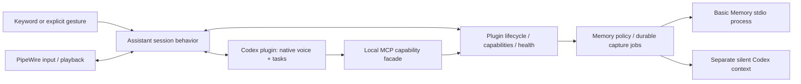

# Personal Agent architecture

Personal Agent is a modular Python application for a reactive personal assistant. A single asyncio host coordinates trusted local plugins. Codex supplies the current reasoning, task and native voice implementation. Devices and local long-term memory remain replaceable. “嘟嘟” is a wake-word setting; neither it nor DELL is the application identity.

## Boundaries

| Location | Owns | Must not own |
| --- | --- | --- |
| `kernel/` | API v1 contracts, dependency order, handler dispatch, task/resource tracking, event fan-out, generations | Devices, Codex protocols, assistant policy |
| `assistant/` | Wake/continuous dialogue/idle, interruption policy, explicit controls | Provider RPCs, vector search, Bluetooth discovery |
| `plugins/codex/` | One foreground provider thread, its voice transport and native task delegation; separate maintenance context | Device drivers, long-term memory storage |
| `devices/` | Shared inventory, adapter-owned registration, timestamped state, read-only query routing external audio and video provider registration | Hardware protocol code, conversation activation |
| `plugins/pipewire/` | Stable input/output selection, device observations, optional AEC, bounded playback and cleanup | Conversation or task policy |
| `plugins/airplay/` | Optional RAOP discovery/identity, bounded PCM encoding, receiver session and cleanup | Conversation policy, microphone drivers |
| `plugins/v4l2/` | Stable Linux video identity, explicit bounded JPEG capture and cleanup | Conversation policy, gesture inference or automatic recording |
| `plugins/keyword/` | Local KWS and VAD models | Remote transcription or task dispatch |
| `memory/` | Source/version policy, durable pending jobs, replaceable provider contract | User task execution, custom embeddings or ranking |
| `bootstrap.py` | Explicit selection and capability bindings | Protocol implementation |
| `headless.py` | Hardware-free management/trigger host | Pretending unavailable voice/brain is operational |

A capability request has exactly one handler and a timeout. It returns a result or an error. `Control`, `Trigger`, `MemoryRequest`, `DeviceQuery`, and `VideoCapture` are separate typed requests. CLI, explicit local commands and the Codex MCP facade use the same handlers. The user explicitly authorized preapproval for this project’s own `memory` and `device` tools; the project thread exposes only these two tools from its local server. No global Codex approval configuration is changed. Fact events have a source, timestamp, correlation ID and plugin generation. Each subscriber has a separate bounded queue; overflow drops its oldest event and increments its counter. Events are observations, never a durable task queue.

Audio uses a separate bounded path. Format/rate/time/connection generation are explicit at the Codex output boundary. Existing Chromium WebRTC jitter handling, PCM silence preservation, playback epoch checks and bounded queues remain in the audio adapters. Stop clears the local queue and terminates playback without waiting for Bluetooth reconnection. The native protocol does not expose a per-answer audio ID: same-connection late audio still uses the existing quiet-boundary suppression heuristic. Connection generations cannot eliminate that protocol limitation.

## State and ownership

- `wake_words` selects equivalent phrases supported by the installed FSMN V2 bundle, handled by one KWS stream and one activation path. The keyword plugin owns 80ms batching, bounded native features/CTC history, one ONNX inference thread and checksum validation. Inference runs off the event loop; generation changes invalidate results across sleep/session resets. The inference-only upstream FunASR decoder is vendored with its MIT license, without a Torch/FunASR runtime dependency. Local commands strip any configured leading phrase before parsing.
- Assistant owns standby → connecting → active → reconnecting → standby. Only explicit wake/trigger activates it. Background work never activates voice.
- Codex owns foreground task state. SQLite logical task IDs and a logical session → provider-thread mapping keep application records independent of opaque provider IDs. Native voice delegation remains the sole task dispatcher; transcripts are not dispatched a second time.
- The audio adapter owns selected output and device availability. It reconnects that output and never silently changes rooms.
- The player owns queue/epoch/mute state. Stop, cancel-task and end-session are distinct operations.
- Memory is not provider chat history and cannot prove an action completed. It is sourced, revisable context.

Disconnect recovery runs as a tracked task, leaving the event consumer available. Unknown task outcomes remain unknown and are reconciled from provider state after restart; no input replay. The critical Codex provider failure restarts the service through systemd. Optional memory failures degrade that capability and retry without stopping capture/playback. Contexts own spawned tasks and async cleanup, and generations reject stale request results/events. Plugins in one process are trusted code, not security sandboxes; native-library crashes remain process-wide failures.

## Long-term memory

The default backend is Basic Memory 0.23.0, via the official MCP SDK and stdio, in a child process using the **same `.venv`**. Its auto-update and cloud routing are disabled. FastEmbed runs the multilingual MiniLM model locally, with 384-dimensional embeddings and no reranker/API key. Upstream Markdown and indexes are the source of retrieval; host SQLite only stores capture jobs, revisions and tombstones. A provider protocol supports `search/read/upsert/delete/export/import`; unit tests run it with a second in-memory implementation.

Explicit memory operations run through the capability handler. Automatic capture batches new transcripts on end-session/task-completion. A separate, ephemeral, read-only Codex context proposes structured facts while the foreground is idle. It has no local capability tools; waking preempts its task. The host checks source IDs and verbatim evidence, bounds size/scope, requires revision matches for corrections and applies idempotent writes. Source checks verify provenance, not semantic truth; model selection of stable facts remains subject to evaluation.

Memory metadata includes logical ID, scope, time, source and revision and is stored in Markdown frontmatter. Metadata is excluded from embedding text. Explicit corrections invalidate older capture batches. Forget records a tombstone **before** upstream deletion; reads, recall and export hide it even when deletion fails. Old batches and imports cannot revive tombstoned IDs. Pending physical deletes are retried. Chat transcripts and provider history are not erased by forgetting long-term memory.

A bounded ready snapshot is supplied at wake without waiting on retrieval. Additional relevant recall is available through the memory tool. Export transfers portable facts and provenance, not embeddings; another backend or embedding model must rebuild its own index. Memory failure must be reported as unavailable/pending, never as a successful save.

## Extension and deployment

Bundled adapters are explicit entries in the composition root; configured capability bindings choose their owners. Trusted local factories may be registered with `local_plugins.name="package.module:factory"`, enabled in `plugins`, and selected in `bindings`; the factory receives the composition context (service). New trusted plugins use a manifest/API version, lifecycle context, handlers and/or fact events. The simulated `wave` gesture exercises the same `Trigger` request as future camera perception; gesture inference is not installed; explicit camera capture is provided by the optional V4L2 adapter.

The default execution model remains one Python environment, one asyncio host and managed child processes. No container, plugin marketplace, hot reload, message broker, or management website is required. The installer only renders/enables a user unit. Host Bluetooth codec settings are optional deployment-profile material, never applied by generic installation. Root/workspace/model paths and stable device identities live in instance TOML; headless management and kernel tests need no audio hardware or models.

## Hardware onboarding standard

Use this procedure for every new hardware input/output. The shared `DeviceDirectory`/`DevicesPlugin` now registers configured devices, routes read-only `DeviceQuery(list/inspect)` to adapter probes, and reports bounded, timestamped `DeviceObservation` snapshots. The existing microphone and Bluetooth speakers use this path. Protocol discovery, actuator operations and new media transports remain adapter-specific; a configuration declaration alone cannot supply an absent driver.

### One integration package

Keep one adapter per protocol/device family under `plugins/<family>/`. Use separate instances/config entries for physical devices of the same family; do not duplicate the driver for each room. Each integration supplies:

- A short README identifying supported models, protocol, system prerequisites, configuration, supported capabilities and known limits.
- A plugin manifest/factory and lifecycle implementation. Use `context.spawn` for owned background work and `context.own` for cleanup; construction must not connect or pair hardware.
- The protocol adapter, including data decoding, availability and reconnection. Prefer maintained protocol libraries over custom Bluetooth/AirPlay implementations.
- Contract tests with a fake transport and a separate explicit real-device acceptance entry point. Private evidence goes under `state/acceptance/<integration>/`.
- An example configuration containing placeholders. Local addresses, pairing credentials and real readings stay outside Git.

Use stable logical IDs such as `living_temperature` and `living_homepod` in assistant requests. Bluetooth addresses, USB serials and network addresses belong to the adapter's instance configuration. A device label/room is editable and is not its identity. Never identify a device by a transient enumeration number.

### Three paths, with different semantics

| Device path | Contract | Meaning |
| --- | --- | --- |
| State/commands | Typed capability requests and structured results | Query a sensor or request a device action; caller receives a timeout/error/result |
| Observations | Bounded `Event` stream | Report a new reading or availability change; publishing alone does not notify the model |
| Media | Dedicated bounded media path | Audio/video frames; do not send PCM or video through the generic event bus or memory |

An adapter reports measurements with device ID, metric, value, unit, sample time, reception time and validity/freshness. State distinguishes unavailable, stale and current readings. Historical values may be returned only when explicitly labeled; a missing device must not silently become another device. Keep sensor snapshots separate from long-term memory. Persist history only when an actual feature requires it, with retention defined for that feature.

A media output implements the stdlib-only AudioOutputProvider / PlaybackTransport protocols: prepare availability, open a rate-specific PCM writer, bounded write, health, volume and close/flush. External providers register through host.audio_outputs; the existing audio owner opens them and mirrors their input into its reference bus without another physical output. A media output preserves explicit format/rate, availability and connection-generation handling. A transport that cannot discard buffered audio reports that limitation; accepting a playback command does not prove audible playback. HomePod uses the optional AirPlay adapter registered under the existing audio routing owner; its microphone is not an input capability. No alternate assistant conversation policy is installed.

A video input implements VideoInputProvider and registers through host.video_inputs. One shared devices owner routes VideoCapture by logical ID and returns a bounded, generation-aware VideoFrame. V4L2 captures only on explicit requests; no continuous acquisition or recording occurs in standby. CLI can explicitly save a JPEG; Codex receives native MCP image content through device snapshot. Only capture metadata enters events, never pixels or automatic memory. Future video streaming/gesture detection requires an explicit media consumer and trigger policy.

### Capability ownership and AI access

Define a concrete request contract in `kernel/contracts.py` only when the first integration needs it. Keep protocol-specific fields in the adapter. The current runtime permits one handler per request type: when multiple sensor/device plugins implement the same ability, a single capability owner routes by logical device ID to the matching adapter. Individual physical devices must not each register the same request type. Do not create a universal arbitrary-method execution tool.

The shared directory contains enabled logical IDs, labels/locations, declared capabilities and freshness-aware availability. Every adapter registers devices during start and updates observations in owned background work. One directory plugin owns the query request type and validates that all enabled configuration entries were registered. A future state sensor can reuse list/inspect without changing the directory or adding another handler.

Expose narrowly defined tools through the local capability facade; CLI and Codex use the same handlers and result semantics. The service request dispatcher must route those new requests to the capability owner. Current `device` list/inspect tools automatically expose registered descriptors and non-media state. Existing audio actions stay on their explicit control route. Add only additional tool schemas required by a new action; read and mutating actions have distinct descriptions/approval semantics, and existing tool authorization is not implicitly widened.

Provide enabled-device descriptions at voice-session startup so the voice layer can delegate appropriate queries/actions to Codex. The model reads actual state through tools rather than guessing from a description. Measurements and external-device labels are data, not instructions. Do not copy arbitrary BLE payloads into system/developer prompts.

Events update local state by default. Only an explicitly configured trigger calls `Trigger`; passive temperature updates do not wake the assistant. A future alert rule separately defines conditions, freshness, debounce/cooldown, action and whether standby may be interrupted. Do not forward every high-frequency sample to the model.

### Configuration and host integration

Local plugin factories are registered through `local_plugins`, enabled in `plugins`, and selected by the relevant `bindings`. The factory receives the host, including its shared device directory. Every physical device is configured under `devices.<logical_id>` with adapter/kind/label/location, optional enabled/max_age_seconds and an adapter-owned connection table. The strict Config loader validates common metadata, adapter enablement, device count and voice selection; each adapter validates its connection schema before touching hardware. There are no old source_match/speakers/room_labels configuration aliases.

Adding a new device from an already supported family should then require instance configuration only. Adding a new protocol requires an adapter; adding a new category of ability may also require a capability contract/tool/host binding once. Hardware identities and operating-system paths must remain configurable for Linux hosts. Generic installation must not modify Bluetooth ownership, audio codecs or global permissions.

### Repeatable acceptance

An integration is complete only when its README includes results for:

1. Valid/invalid configuration, stable logical identity and supported-device/protocol checks.
2. Real data/action and independent physical confirmation where applicable (known temperature comparison, audible playback, or the target actuator's actual state).
3. Caller-visible device-not-found, malformed data, permission denial, timeout and stale-reading behavior.
4. Disconnection/reconnection without duplicate actions, stale generations or silent device substitution. Retry read operations; do not replay actions with uncertain outcomes.
5. Service restart recovery and cleanup, bounded queues/state, and CPU/memory measurements appropriate to a continuously running device.
6. The actual AI tool path, including selecting the intended device and reporting true errors. A fake driver test alone does not establish this.
7. Coexistence with voice capture/playback and standby privacy. Passive sensor input must not activate a conversation; only the configured explicit trigger may do so.

For a BLE temperature sensor the first implementation includes protocol identification, one sensor adapter, connection validation, freshness-aware observations and real-device acceptance. It reuses the installed directory/read capability and read-only tool. For a second sensor using that same protocol, reuse all of those pieces and add its instance configuration. Commit source/config examples/tests; retain readings, recordings, logs and pairing data in ignored instance storage.

## Evolution rules

Add concrete capabilities when an extension needs them; do not expand a universal event object into a second RPC system. Keep media work bounded and expensive memory work out of the audio process. Preserve task and memory state during code rollback. Tests belong beside the behavior they protect, and one check command runs formatting, static checks and unit contracts. No compatibility package or old CLI is shipped during development.
