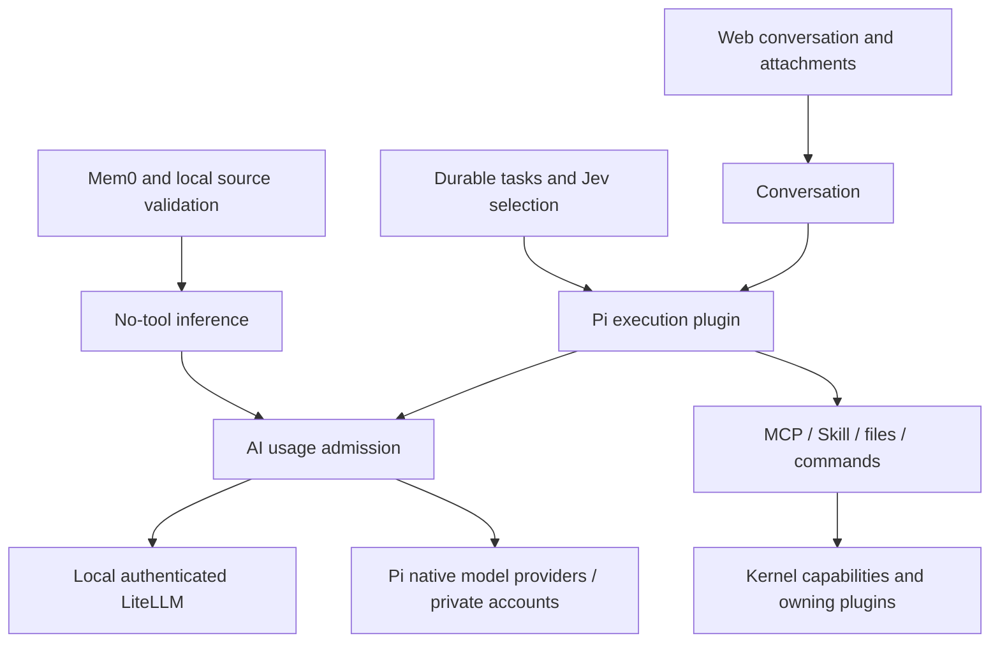

# Personal Agent architecture

Personal Agent is a modular asyncio host. Pi is the sole execution harness. The unified model registry routes API endpoints through a local LiteLLM gateway or configured native accounts through Pi's provider library. Web text and registered images are the current main entrance. Voice input/dialogue/playback and OS-level execution sandboxing are explicit TODOs. No placeholder audio, fake account or simulated readiness is allowed.

CLI `run` always starts the same application host and its configured plugins. The headless profile does not substitute a minimal test host or omit Web, models, tasks, events or metering. Audio availability belongs to the selected speech plugin and fixed device bindings.

## Ownership and boundaries

| Owner | Responsibility |
| --- | --- |
| kernel | Standard-library contracts, bounded event fanout, plugin lifecycle and request dispatch |
| bootstrap | Select concrete plugins, wire capabilities and dependencies |
| conversation | One durable main conversation, registered media, idempotent requests, tool/result presentation |
| tasks | Definitions, schedules, inbox, run identity, model choice, checkpoints, goals, feedback ownership and durable trace |
| plugins/pi | Native Pi RPC, isolated execution sessions, model/effort confirmation, normalized execution events, MCP/Skill configuration |
| plugins/ai_usage | Mandatory AI-service admission, durable metering, budgets, statistics and usage attention |
| plugins/models | Single immutable model registry, bounded no-tool inference and durable receipts |
| integrations | Revisioned trusted MCP definitions, caller scopes, credentials, discovery and idle refresh |
| devices and device plugins | Stable identity, capabilities, resource leases, operation receipts and hardware protocols |
| notifications | Durable inbox, semantic grouping, deduplication and channel delivery |
| memory | Upstream Mem0, local vectors/history and original evidence validation |

`kernel/execution.py` declares the provider-neutral executor commands/events. Session commands create/resume/read/close an execution context. Run commands submit/steer/cancel an attempt. Activity events contain tool identity, phase and observed result. The adapter translates native Pi messages once; the host does not simulate another provider's protocol. Unknown commands fail explicitly.

Main and background work share the same executor implementation and immutable model registry, with separate Pi processes and session files. Auxiliary inference and memory extraction use models directly, with no tools and no second agent loop. Source code contains no subscription/API executor split, compatibility aliases or test-dependent runtime branches.

## Model configuration and execution evidence

`main_model` and `main_reasoning_effort` reference a configured model alias. `model_api` owns providers, entries, memory binding, gateway limits and declared capabilities. Task profiles reference those same aliases. A model's provider, upstream name, images, context window, output budget and supported reasoning levels are explicit. Unregistered/unvalidated models and unsupported inputs fail before submission.

`model_api.accounts` names provider-owned authentication methods. A native provider references exactly one account; endpoint providers keep their explicit protocol and key reference. `plugins/pi/accounts.*` adapts the pinned upstream provider library and its locked credential store, not another agent. Execution forwards Pi's normalized transcript/events; auxiliary inference supplies no tools. Credentials stay under private `state/model-accounts/<account>/`, separate from Coding AI/Codex/global Pi state. Login is operator-only, never an MCP tool. Native inference passes the same durable usage admission before sending and settles before tool execution; cancellation aborts the native request without replay. Native provider/effort/capability checks occur before dispatch. ChatGPT OAuth requires explicit `output_limit="model"`: its route rejects per-request output caps, so reservation uses the native model's advertised maximum, never the smaller gateway cap. This is a catalog bound, not proof of supplier enforcement. Other unsupported limits fail before dispatch.

Pi's models/settings/MCP files are derived private files, never another editable registry. Each execution receives a stable `x-assistant-session` identity, an explicit project Skill inventory and a captured MCP revision. Pi and gateway automatic retries are disabled; only the existing framework's explicitly configured fallback can start another attempt after proof that no work occurred. Jev may advise on candidates but cannot expand authorization or establish operation success.

The adapter checks Pi's actual selected model/effort before a prompt. Configuration errors are not swallowed. Model upgrades require the task owner's checkpoint and no active/unknown operations, archive the old context, and start a fresh context. User-explicit choices remain protected.

AI-service admission belongs to `plugins/ai_usage`, with plugin-owned configuration and a private SQLite ledger on a dedicated bounded worker. Pi retains protocol transport only; models, memory, Jev and paid search share the gate. Host-bound work identity survives children, continuation, fallback, model changes and restart. Defaults are 100 upstream attempts per work, warning at 50; all other consumption hard limits are opt-in. Reservation precedes sending, settlement precedes observed completion; missing usage is unknown telemetry, not a failed business operation. Metering failure blocks new AI dispatch while devices/events/web continue. Task plans pause on durable consumption limits; attention follows existing result-delivery ownership. See the [plugin guide](src/assistant_runtime/plugins/ai_usage/README.md).

## Lifecycle, cancellation and restart

Admission, event queues, input size, normalized hot history and process counts are bounded. Metadata is privately and atomically committed before dispatch and before reporting observed tool activity. A lost response or unexpected process exit yields unknown, never success or automatic replay. The hot execution projection retains 100 runs; durable chat/task evidence remains in business storage and Pi retains its native compactable session.

Cancel first clears queued input, aborts native work and waits for run termination plus tool settlement. Cancel failure propagates. A metadata record left active/unknown across restart blocks fresh execution until explicitly reconciled; it is not proof that external operations stopped. Plugin contexts own subprocess cleanup and event consumers. Shutting down the host does not repeat work.

Long-term objectives, authorization and final completion belong to tasks. The Pi goal tool reports progress to that owner; a model's report does not change the task's authorized objective or schedule. Runtime execution metadata is an adapter receipt, not a second task database.

## Conversation, results and notifications

Web and CLI text share durable request identities and the same conversation service. Inputs are registered before dispatch; subsequent input supplements the active run. Tool output, webpage text, images, memories and task reports are data. User clarification is correlated with the waiting execution. Images are size bounded and use registered references at public MCP boundaries.

Tasks own result-delivery rights. A delegated task actively claimed by the main conversation returns there; detached work uses notifications. Ownership transfer is versioned and receipt based, not a wall-clock timeout. Task/execution/event identity drives grouping independent of message ordering. A single-item group renders as one notification; task reports and attachments default collapsed and link to the task. Trace exposes tool phases and status, not hidden reasoning or raw credentials. Tool completion does not establish business success.

## Voice and execution permissions

Voice is unavailable and never starts a microphone stream. Fixed USB input/output bindings and independent acoustic acceptance scripts remain. Device audio/video tools remain separate capabilities and cannot replace the fixed bindings. Placeholder wake/playback success is forbidden. A future voice adapter must pass independent input, interruption and output acceptance before enabling capture or playback.

Pi file and command execution currently runs with full local permissions (`-na`); no OS sandbox is claimed. MCP allow/deny/approval scopes and server-bound task identity remain business constraints. Unimplemented MCP OAuth fails explicitly; configure credentials and verify the server. Neither prompt instructions nor extensions are presented as an OS sandbox.

## Configuration, state and deployment

Private `config/` explicitly includes fragments; `config.example/` is the reusable template. `.env`, state, credentials and models remain under the instance root. New installs use a pinned Pi CLI and ship the TypeScript extension in the wheel; `scripts/setup_pi.sh` performs the explicit external installation. `scripts/check.py --group execution` runs executor checks; the full check additionally covers all domains and frontend build.

The cutover has no legacy dialogue/task migration. `scripts/reset_execution_state.py --root ROOT` previews counts. Apply only with the assistant stopped and external actions checked; it backs up the database and configuration, retires old task-linked notices, clears execution/dialogue/plan tables, and is idempotent. It preserves memory source transcripts, media, events, credentials and actual files. New tasks are created explicitly. Changing code/config does not itself authorize killing in-flight operations.

Acceptance distinguishes local synthetic transport, real-provider behavior and deployed readiness. API credentials/data/budget require explicit scope. A past Codex acceptance receipt does not validate Pi. Gateway failures must not block event ingestion, device observations or notification persistence.

## Hardware onboarding standard

Use this procedure for every new hardware input/output. The shared `DeviceDirectory`/`DevicesPlugin` now registers configured devices, routes read-only `DeviceQuery(list/inspect)` to adapter probes, and reports bounded, timestamped `DeviceObservation` snapshots. The existing microphone and Bluetooth speakers use this path. Protocol discovery, actuator operations and new media transports remain adapter-specific; a configuration declaration alone cannot supply an absent driver.

### One integration package

Keep one adapter per protocol/device family under `plugins/<family>/`. Use separate instances/config entries for physical devices of the same family; do not duplicate the driver for each room. Each integration supplies:

- A short README identifying supported models, protocol, system prerequisites, configuration, supported capabilities and known limits.
- A plugin manifest/factory and lifecycle implementation. Use `context.spawn` for owned background work and `context.own` for cleanup; construction must not connect or pair hardware.
- The protocol adapter, including data decoding, availability and reconnection. Prefer maintained protocol libraries over custom Bluetooth/AirPlay implementations.
- Contract tests with a fake transport and a separate explicit real-device acceptance entry point. Private evidence goes under `state/acceptance/<integration>/`.
- An example configuration containing placeholders. Local addresses, pairing credentials and real readings stay outside Git.

Use stable logical IDs such as `living_temperature` and `living_homepod` in assistant requests. Bluetooth addresses, USB serials and network addresses belong to the adapter's instance configuration. A device label/room is editable and is not its identity. Never identify a device by a transient enumeration number.

### Three paths, with different semantics

| Device path | Contract | Meaning |
| --- | --- | --- |
| State/commands | Typed capability requests and structured results | Query a sensor or request a device action; caller receives a timeout/error/result |
| Observations | Bounded `Event` stream | Report a new reading or availability change; publishing alone does not notify the model |
| Media | Dedicated bounded media path | Audio/video frames; do not send PCM or video through the generic event bus or memory |

An adapter reports measurements with device ID, metric, value, unit, sample time, reception time and validity/freshness. State distinguishes unavailable, stale and current readings. Historical values may be returned only when explicitly labeled; a missing device must not silently become another device. Keep sensor snapshots separate from long-term memory. Persist history only when an actual feature requires it, with retention defined for that feature.

Each logical endpoint has exactly one adapter owner. Optional `physical_id` associates multiple endpoints of one piece of hardware without merging their owners or availability: HomePod playback uses AirPlay while its sensor endpoint uses Apple Home; a USB camera can have separate video/audio endpoints. An endpoint without an explicit association uses its logical ID. A sibling being online does not establish measurement availability.

The stdlib-only `SensorReading` contract carries one metric's numeric value, unit, source, sample timestamp and validity. Adapter decoding/validation produces this contract; the directory checks declared metric capabilities and serializes it under `readings`. Every metric has independent age/freshness. Unchanged heartbeats cannot reset its monotonic ageing. Unavailable/calibrating metrics have no current numeric value; a retained expired reading is marked stale. Configuration controls the freshness limit. Neither device discovery nor MCP maintains a second sensor registry.

The optional Apple Home adapter uses upstream HAP-python for a paired virtual Lightbulb refresh trigger and a bounded authenticated HTTP route for Home automation readback. Source timestamp/order validation happens before atomic replacement of the latest private SQLite snapshot. Refresh is bounded, coalesced and optional; failure degrades the source, not another endpoint or the assistant. Pairing/accessory identities persist across restart and later additions. Apple-side automation must be configured once against real Home/accessories; synthetic HTTP/MCP acceptance does not prove real HomePod acquisition. Measurements publish metadata observations without activating voice, task dispatch or long-term memory. CLI and existing device MCP queries reuse the directory; no HomePod-specific model tool is introduced.

The device inventory marks `voice_role=input|output|null` and `voice_binding_locked`.
Binding fixes the conversation route, not exclusive ownership of that physical endpoint:
a tool may target either a main or additional device by its explicit logical ID.
`capabilities` describes hardware; `tool_operations` lists registered executable actions,
and `media_streams` describes the implemented stream providers and sharing policy.
A descriptor does not imply an unimplemented microphone, speaker or video-output tool.

`host.audio_inputs` / `host.audio_outputs` own independent PCM transports and resource
leases for both main voice and tool consumers. An adapter registers an AudioInputProvider
or AudioOutputProvider and explicitly declares whether streams may share the endpoint.
The default is exclusive: a busy resource returns an error without closing, moving or
replacing its owner. PipeWire declares independent capture streams/mixed playback;
AirPlay remains exclusive per receiver. Closing a stream affects only that stream;
a lease is released after successful transport cleanup. Failed cleanup retains the lease.
Related sensor/speaker/camera endpoints may share `physical_id` without implying the
same resource; the adapter must declare actual contention. Raw provider access is for
inspection/volume only; stream acquisition always goes through the registry.

Audio input is bounded mono PCM16 data for its explicit consumer, not a conversation
turn, wake trigger, instruction or automatic memory. New tool-side recording/playback
requires its own typed request, bounded handler and narrow MCP schema. It must not borrow
the voice player/capture, activate voice, select a route or use a fallback device.
This framework supplies the ownership path; it adds no speech synthesis, transcription,
music source or room-specific listening feature. External voice output may mirror its
own PCM into the existing AEC reference bus without playing through another speaker.
Accepting PCM proves submission, not audible physical playback.

`DeviceOperations` coordinates existing snapshot, recording, camera motion and volume
handlers through explicit operation IDs. Resources are per logical endpoint and named
function, so an unrelated operation does not block another device. Camera stop remains
available while motion is busy; the adapter owns the physical stop and its cleanup.
Operation workers and cleanup belong to the devices plugin lifecycle. MCP can query or
cancel one operation without canceling main voice or other work. Caller disconnect and
timeout cancel that operation and wait for adapter cleanup; cancellation does not undo
already delivered physical effects. Mutating failures may have an unknown outcome.
SQLite retains identity/state/timing receipts across restart, while in-memory completed
metadata and list queries are bounded. Receipts contain no PCM, images, credentials or
request text. A restarted running operation becomes unknown and is never replayed;
reusing an ID requires querying its receipt, never executing it again.

`set_audio_volume(device_id, percent)` targets that registered speaker without changing
the binding. A response with `applied=false, scope=next_stream` is only a saved preference.
`stop_playback` and `end_voice_conversation` remain explicit controls of the main session.

A video input implements VideoInputProvider and registers through host.video_inputs. One shared devices owner routes VideoCapture by logical ID and returns a bounded, generation-aware VideoFrame. The go2rtc adapter requests uncached snapshots only on explicit input; its metadata observer never opens a video consumer. The separately managed gateway owns USB V4L2, RTSP and other camera protocols, formats and optional transcoding. The assistant neither opens video nodes nor launches camera FFmpeg processes. Gateway reachability and stream registration are distinct from successful acquisition; `capture_verified` describes a successful frame in the current observed source generation. Source changes or observed outages invalidate that generation, and failed requests never return earlier pixels. CLI can explicitly save a JPEG; execution adapter receives native MCP image content through device MCP capture_image. Only capture metadata enters events, never pixels or automatic memory. Future video streaming/gesture detection requires an explicit media consumer and trigger policy.

### Capability ownership and AI access

Directional camera actuation uses the typed `CameraMotion` request and the shared
`CameraControls` registry, separate from media acquisition and assistant voice
controls. Only explicitly configured, physically verified movable endpoints
declare `camera.pan_tilt`; fixed lenses retain snapshot/recording capabilities without motor control. The go2rtc adapter
owns bounded active-session acquisition, short motor requests, stop/cancellation
and cleanup. No movement is retried on uncertain outcomes, and command delivery
does not imply measured position. The MCP `move_camera` and `stop_camera` tools
translate requests without camera protocol code. Directions, duration limits and
lack of angle feedback are discoverable through the existing device directory.

Define a concrete request contract in `kernel/contracts.py` only when the first integration needs it. Keep protocol-specific fields in the adapter. The current runtime permits one handler per request type: when multiple sensor/device plugins implement the same ability, a single capability owner routes by logical device ID to the matching adapter. Individual physical devices must not each register the same request type. Do not create a universal arbitrary-method execution tool.

The shared directory contains enabled logical IDs, labels/locations, declared capabilities and freshness-aware availability. Every adapter registers devices during start and updates observations in owned background work. One directory plugin owns the query request type and validates that all enabled configuration entries were registered. A future state sensor can reuse list/inspect without changing the directory or adding another handler.

Expose narrowly defined tools through the local capability facade; CLI and execution adapter use the same handlers and result semantics. The service request dispatcher must route those new requests to the capability owner. Current `device` list/inspect tools automatically expose registered descriptors and non-media state. Device volume uses `AudioVolume`; main-session interruption stays on its explicit control route. Add only additional tool schemas required by a new action; read and mutating actions have distinct descriptions/approval semantics, and existing tool authorization is not implicitly widened.

Provide enabled-device descriptions at voice-session startup so the voice layer can delegate appropriate queries/actions to execution adapter. The model reads actual state through tools rather than guessing from a description. Measurements and external-device labels are data, not instructions. Do not copy arbitrary BLE payloads into system/developer prompts.

Events update local state by default. Only an explicitly configured trigger calls `Trigger`; passive temperature updates do not wake the assistant. A future alert rule separately defines conditions, freshness, debounce/cooldown, action and whether standby may be interrupted. Do not forward every high-frequency sample to the model.

### Configuration and host integration

Local plugin factories are registered through `local_plugins`, enabled in `plugins`, and selected by the relevant `bindings`. The factory receives the host, including its shared device directory. Every physical device is configured under `devices.<logical_id>` with adapter/kind/label/location, optional enabled/max_age_seconds and an adapter-owned connection table. The strict Config loader validates common metadata, adapter enablement, device count and voice selection; each adapter validates its connection schema before touching hardware. There are no old source_match/speakers/room_labels configuration aliases.

Adding a new device from an already supported family should then require instance configuration only. Adding a new protocol requires an adapter; adding a new category of ability may also require a capability contract/tool/host binding once. Hardware identities and operating-system paths must remain configurable for Linux hosts. Generic installation must not modify Bluetooth ownership, audio codecs or global permissions.

### Repeatable acceptance

An integration is complete only when its README includes results for:

1. Valid/invalid configuration, stable logical identity and supported-device/protocol checks.
2. Real data/action and independent physical confirmation where applicable (known temperature comparison, audible playback, or the target actuator's actual state).
3. Caller-visible device-not-found, malformed data, permission denial, timeout and stale-reading behavior.
4. Disconnection/reconnection without duplicate actions, stale generations or silent device substitution. Retry read operations; do not replay actions with uncertain outcomes.
5. Service restart recovery and cleanup, bounded queues/state, and CPU/memory measurements appropriate to a continuously running device.
6. The actual AI tool path, including selecting the intended device and reporting true errors. A fake driver test alone does not establish this.
7. Coexistence with voice capture/playback and standby privacy. Passive sensor input must not activate a conversation; only the configured explicit trigger may do so.

For a BLE temperature sensor the first implementation includes protocol identification, one sensor adapter, connection validation, freshness-aware observations and real-device acceptance. It reuses the installed directory/read capability and read-only tool. For a second sensor using that same protocol, reuse all of those pieces and add its instance configuration. Commit source/config examples/tests; retain readings, recordings, logs and pairing data in ignored instance storage.

## Media acquisition

The optional `plugins/media/` owns public-share acquisition and independent media MCP/CLI.
It reuses tasks for tracking plans, notifications for delivery and the standard event
reporter for observations. PanSou, account-scoped Aliyun/Quark and OpenList remain separate adapters; the
kernel only adds `MediaRequest`. Explicit account aliases bind targets and credentials;
capability discovery reports per-account actions and rejects unsupported operations.
Mounted-file management has a separate configurable `file_backend`: native adapters
or the reusable OpenList filesystem port. OpenList path references never masquerade as
cloud IDs; its plans and downloads reuse media's durable queue, grants and verification.
Native share acquisition remains independent. New mounted storages can bind the
OpenList backend without copying cloud credentials. Missing upstream hashes and unsafe
recycle semantics stay explicit capability limits; there is no automatic backend fallback.
Confirmed cloud changes atomically mark affected directories in each media operation's
`openlist_sync` receipt. A lifecycle-owned worker coalesces bounded refreshes and retries
only reads; cache synchronization never changes cloud-operation success or replays writes.
Native folder IDs resolve below the configured cloud root into the explicit OpenList mount
mapping. Move refreshes both parents; partial batches retain their completed-step refreshes.
Aliyun auth uses bounded owned SDK subprocesses; Quark uses bounded HTTP with private
Cookie rotation. Async provider copy receipts are durably stored before observation;
one credential lease/lock owns refresh and atomic replacement. Credentials stay private,
never in MCP, event records, config examples or shared execution adapter settings. Host SQLite owns
operation IDs, intent snapshots, hash/size verification and the durable notice outbox.
Original-file downloads use a separate owned worker with bounded HTTP streaming and
off-loop disk IO. A required mounted filesystem, private staging outside the published
library and atomic no-clobber publication prevent accidental SSD writes or incomplete
playable entries. Complete checksum validation precedes local completion; signed URLs
are short-lived internal capabilities and never enter receipts/MCP. Copy and download
have separate operation identities, recovery and completion evidence.
Adapters may supply origin-bound download credentials; the HTTP worker forbids redirects
and cookie persistence. Provider hashes (MD5/SHA-1/SHA-256) verify complete bytes before
publication; multipart ETags or locally generated hashes alone are not upstream evidence.
Submitted/unknown writes reconcile on restart instead of replay. Background writes
require an active task and its explicit `media:TARGET` resource; interactive login stays
in the main conversation. Cloud completion, OpenList availability and physical playback
are different evidence. See the [media plugin](src/assistant_runtime/plugins/media/README.md).
Transfer completion requires a fresh provider-neutral file identity/parent/metadata
readback. `cloud_verification` and mounted-path visibility are separate timed receipts;
OpenList paths are explicit mappings, never inferred from cloud ancestry. Revalidation
does not replay copy, and unverified paths cannot be published as verified locations.
Capability discovery supplies exact target/account/provider resource bindings before
delegation. The tasks owner exposes revision-checked, foreground-only correction of a
stopped run's resources, with a persisted before/after receipt and no automatic replay.
Internal binding errors do not require users to repeat existing semantic authorization;
background tasks cannot promote themselves or cross parent scope.

Public discovery also stays in media: bounded explicit title/alias fan-out through
PanSou, platform/share identity normalization, immutable pages, durable bounded search
summaries and short-lived exact-scope share observations. Discovery capability is
separate from acquisition. PanSou owns its source adapters and scraping; per-query
completion is unknown where upstream supplies no receipt. Recent source health cannot
be presented as query completion or global absence. No model routing policy changes
or additional search/agent loop accompany these capabilities.

Media library management remains inside that plugin: stable provider IDs and separate
last-observed locations, revisioned collection criteria, bounded preconditioned change
plans, and durable batches over existing operation workers. Aliyun owns cloud writes;
local management uses mounted, same-volume, no-follow filesystem operations and private
trash. Unknown writes reconcile without replay; cancellation preserves completed steps.
Batch notification aggregation does not create another scheduler. Tasks own periodic
checks and controlled plan completion; cloud save, organized placement, local checksum,
OpenList visibility and actual playback stay separate evidence.

## Durable notifications

`plugins/notifications/` owns the stable inbox, producer-scoped event identity, revisions,
revision-aware read/unread state and per-channel delivery receipts. Notifications have
no archive state; corrections become unread again. `NotificationRequest` is the common
capability used by independent notifications MCP, CLI and Web. Task identity is derived
from its run, not accepted from generated content. Publishing commits notification and
outbox before acknowledgement; task completion marks delivery queued only after publish.
The kernel's bounded lossy event bus is not a notification store.

Adapters own transport work, retry safety and delivery receipts. Chat uses stable IDs;
execution adapter context and audio expose uncertain outcomes rather than replaying non-idempotent
side effects. Policies apply at delivery, including idle/quiet periods and expiry. No
worker blocks the main conversation; no notification enables remote microphone input.
Read acknowledgements are user actions and independent of channel success. The inbox
survives provider session replacement. Selected notification evidence joins a follow-up
as quoted data, never as privileged instructions. Mobile push remains an adapter seam.

Notification execution metadata is a read projection through `TaskRequest`, with execution
lookups batched per inbox page. Task event publication and automatic completion notices
are distinct. Timing becoming available does not create a content correction, reset read
state or replay chat/context/voice deliveries. Web refreshes pending execution metadata
without replacing paginated inbox contents.

## Durable event observations

The optional `events` plugin owns only independent SQLite records, validation, bounded
admission, deduplication, revisions/tombstones, quota and queries. It never owns device
protocols, credentials or polling. `Context.event_reporter` supplies a source-bound
kernel contract: `report` confirms durable commit, `offer` confirms bounded admission
only. Advanced producers may atomically checkpoint observations and declare gaps.
Failure is explicit and cannot block the real-time audio path. The kernel imports no
plugin; its lossy event bus carries only committed-update/capacity hints.

`plugins/observations` manages revisioned source configuration and lifecycle through
`ObservationRequest`. Injected producers choose business hooks, subscriptions or their
own bounded polling. Wake business facts remain assistant-owned; Reyee and television
protocols/comparison state live under their own plugin families. There is no global
hardware polling loop or blanket AOP instrumentation. Source changes stop/drain only
the target instance, preserving identity/history and observation gaps.

The independent events MCP/CLI is a facade: `EventRequest` owns record CRUD/query, source
management forwards to `ObservationRequest`. Main and background use the shared MCP
catalogue and authorization rules. Source definitions live in private
`config/observations/sources.json`; credentials in private `state/observations/`;
records remain in `state/events/`. Recording itself starts no model, notification or
memory work; explicitly configured task subscriptions consume committed observations. See [recording contracts](src/assistant_runtime/plugins/events/README.md)
and [source onboarding](src/assistant_runtime/plugins/observations/README.md).

Notification associations are independent of producer ownership and event deduplication.
The notifications plugin owns source-scoped group identity, stable group/member pagination
and snapshot-bounded acknowledgements. Task execution defaults and explicit topic keys
are evidence-based; no title/time similarity or business-completion inference is used.
Trusted producer adapters may enrich legacy associations through internal `NotificationLink`,
never exposed as caller-supplied IPC/MCP authority. Media carries its stored execution
origin through its outbox and restores only its own historical operation links. Original
content, revisions and delivery receipts are not rewritten or replayed by grouping.

## Optional public web search

`SearchRequest` is the shared internal/MCP/CLI contract. The optional search plugin owns
DeepSeek Search/Fetch protocol, public-page validation, reusable HTTP connections,
bounded admission, deadlines, one transient retry, coalescing and ephemeral content cache.
Only bounded call metadata is persisted. MCP binds the active task identity server-side;
main and background/API executors use the same service catalogue. Configuration belongs
to `config/search.toml`, with credential environment references, effective after restart.
Configured does not mean remotely verified; capability inspection makes no paid request.

Pi uses the explicitly configured search plugin; the former subscription Search Service
is not exposed by this executor. Search does not change the execution model or silently
fall back to an unavailable subscription tool. Media acquisition remains in
media; no search agent loop, browser or local crawler is introduced. Third-party page
content is untrusted evidence, never authority. DeepSeek does not expose its final
redirect URL; adapter output explicitly leaves it unknown rather than asserting that
upstream redirects have been locally verified. See [search](src/assistant_runtime/plugins/search/README.md)
for caller contracts, limits, failure semantics and explicit real-provider acceptance.

## Assistant resources and Coding AI tooling

`.agents/` and `.agent/` are ignored local development directories, never runtime
configuration or application assets. Root `AGENTS.md` remains the tracked engineering
guide; Pi disables automatic project context, prompt, extension and skill discovery.
The composition root explicitly selects packaged skills from enabled media, tasks
and events plugins; Pi receives only those paths and explicitly selected private
instance skills. Foreground and background share this one inventory. No global
skill registry or independent knowledge engine is introduced.

Private device procedures and evidence live in `config/skills/<name>/`, selected
by `instance_skills`. Missing entries and shadowing of bundled skills fail startup.
User facts still use the existing memory capability. MCP definitions and observation
source configuration live in `config/mcp/servers.json` and
`config/observations/sources.json`, retaining their plugin-owned validation,
CAS revisions and atomic writes. `config.example/` carries empty reusable templates,
not household identities, runtime receipts or credentials. Configuration takes effect
on explicit restart; there is no discovery or automatic migration from Coding AI files.
