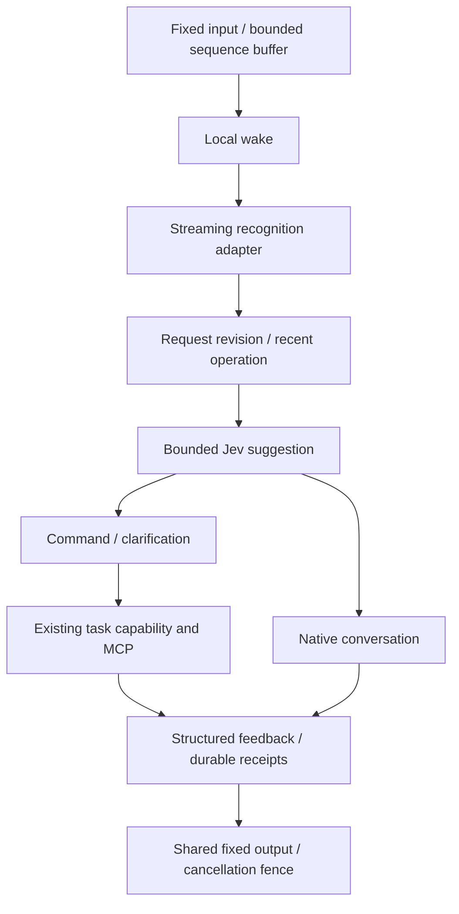

# Voice-first interaction

The command entrance is an **opt-in acceptance candidate**, not the production default.
The local engines tested on this instance did not pass noisy-room accuracy or response
latency acceptance. Do not enable it merely because unit tests pass. The installed
service and fixed USB binding are unchanged by source checks or offline evaluation.



## Ownership

- `kernel/speech.py` defines PCM chunks, recognition results, request identities and
  feedback intents. Adapters know protocols/models; they never own devices or tasks.
- The assistant capture reader only offers bounded, memory-only chunks. A separate
  consumer performs wake/VAD/inference. Cue generation and connection setup cannot
  stop capture. Sequence IDs prevent replaying a chunk into the command recognizer.
- Connecting native voice buffers new input until the transport is ready. Python and
  browser queues fail explicitly on exhaustion; neither drops the beginning of an
  utterance and silently executes its tail. A gap ends native attention or requests a
  repeated command. Transport reconnection is not authorization to replay work.
- `Interaction` owns stable requests, versions, attention and recent operation context.
  A partial utterance invalidates older speech/classification; final recognition creates
  a new request. An accepted correction increments the related operation revision.
  Context expires after 120 seconds except necessary active/unknown task references.
- `TaskRequest` owns durable execution, authorization, model selection and recovery.
  Command execution uses an isolated temporary task, not the full foreground chat
  history. Existing task policy chooses the model; no high-effort implicit inheritance.
- Jev receives bounded text and recent operation data through the existing consented
  `selection` capability. It suggests command/dialogue/correction/uncertain, not tool
  parameters or execution success. The routing deadline defaults to 1 second, within
  the existing 3-second upper limit. Failure uses the existing execution model to
  understand/clarify; it does not synthesize guessed device arguments.
- Explicit stop/sleep/volume/progress controls bypass Jev. `我自己来` in the command
  path cancels only its associated execution and checks its recorded execution state.
  Unconfirmed stop prevents a replacement; already-issued device effects cannot be
  retracted. Native dialogue uses the shared versioned voice-control confirmation owner; native handoff remains non-interceptable.
- Dialogue receives the original buffered utterance once. Do not also submit its
  transcription as a task: native voice may already delegate it. Web remains the
  existing independent entrance and history projection.

## Feedback and output

Acceptance and final feedback have independent durable receipts. A short delay merges
fast results into a single response. Provider `execution_input` acceptance, not web
commentary, drives the legacy path's acknowledgment. Repeated progress stays silent.
The command path generates an explicit acceptance intent with the requested target.

The local output scheduler serializes literal TTS on the existing fixed StreamPlayer.
It paces PCM and checks request revision, attention, interruption generation, expiry,
quiet hours and output errors. Native PCM is suppressed while local output owns the
speaker. Cues and user interruption invalidate old PCM. Receipts distinguish submitted,
outputting, completed, interrupted and unknown. Completed means local transport drained,
**not that a person heard it**. Renderer failure/timeout does not replay a device action
or speech submission; restart turns incomplete speech receipts into unknown.

Command completion leaves a 3-second follow-up window. Closing attention cancels speech,
not an already-authorized task. Late/deferred results use the existing durable notification
outbox and quiet-hours policy. With this path ready, notification rendering does not open
a full native chat session. A positive `perceptible` success intent may be omitted; failure,
unknown and clarification are never omitted on that basis. Current task results do not
provide certified perceptible-success evidence, so this adapter conservatively speaks
their result instead of inferring success from model wording.

## Configuration and replacement

```toml
[interaction]
enabled = false # Enable only after instance-specific acoustic and latency acceptance.
asr_model_dir = "/absolute/models/streaming-asr"
tts_model_dir = "/absolute/models/test-tts/kokoro-int8-multi-lang-v1_1"
tts_voice = 46
follow_up_seconds = 3
context_seconds = 120
acknowledgement_seconds = 0.8
routing_seconds = 1
input_buffer_seconds = 30
```

The composition root injects `StreamingRecognition` and `SpeechRenderer`; bundled
adapters live in `plugins/speech/`. A different adapter must honor reset/close, bounded
work, literal rendering, cancellation and error semantics. Vendor credentials, raw
protocol fields and resampling stay in that adapter. No automatic paid fallback.
Adding a cloud adapter requires explicit credentials, an agreed test budget and raw-audio
authorization; existing Jev text authorization does not authorize sending recordings.
Preparation runs asynchronously and failure leaves the native entrance usable. An
enabled but unready command adapter reports its health and cannot receive commands.

## Measured evidence and remaining gates (2026-10-18)

Existing USB recordings from 客厅中央、客厅远处、厨房、书房, quiet and television noise,
were evaluated locally with streaming Paraformer int8 and Kokoro int8 on the Dell.

- Eight 20-second spoken samples: compute/audio ratios 0.096–0.110. This is throughput,
  not end-to-end response latency; chunks were replayed offline without a wall-clock wait.
- Quiet living-center transcription matched the test sentence; quiet far-living audio
  split into three segments; study omitted the final character. Quiet kitchen actually
  omitted “上午” when spoken: that omission is not an ASR error.
- All four TV-noise samples mixed background speech into the transcript. Noise-only
  samples also produced text. Wake activation alone does not establish directed speech
  for every subsequent utterance. This is an accuracy/safety acceptance failure.
- Literal TTS: 12.096 s cold and 8.975 s warm to render ~4.5–4.8 s sentences. Startup
  warming alone cannot meet the ~1 s / p95 2 s target. No claim of an achieved p95.

The native protocol assessment found: web commentary is not speech, appendSpeech can
paraphrase text, and WebRTC lacks a reliable per-answer PCM identifier. Native handoff
is a notification of delegation, not a pre-execution authorization hook. These are
adapter limits, not problems solved by a more forceful prompt.

A real local browser/WebSocket probe confirmed that exceeding 30 seconds of buffered
input reports `input_gap`. It used synthetic silence, no physical audio devices and no
provider session. Buffer bounds count samples/bytes rather than variable-size frames.
Cloud comparison is deferred at the user's request; this candidate remains disabled.

Reproduce offline (no device use, service changes, cloud calls, or new audio saved):

```sh
.venv/bin/python -m scripts.check_speech_pipeline \
  --asr-model models/streaming-asr \
  --tts-model models/test-tts/kokoro-int8-multi-lang-v1_1 \
  --recordings state/acceptance/audio-input/offline-usb-rooms-20261018T094805 \
  --output state/acceptance/speech-pipeline-local.json
.venv/bin/python scripts/check.py --group speech --group core --group execution
```

The benchmark retains text/timing in private state only when `--output` is given.
It does not infer word error rate from an assumed spoken reference. The original samples
do not cover enough film names, numbers, negations and corrections for default-engine
selection: supplement those with labeled recordings and independent API comparison.
Run connected-device acceptance for contiguous wake/request, slow speech, correction,
barge-in, TV noise, consecutive commands, late results, disconnect, restart and silence
before changing the instance flag. Measure input-ended → first meaningful PCM and output
completion separately. The trace reports stages without audio or transcript payloads.
The local Paraformer adapter cannot provide an exact speech-end timestamp; its
`input_ended` field remains null, separate from `endpoint_observed`. Do not subtract
endpoint detection time and present that as human speech-end latency. First feedback
is measured at the shared player's actual voiced write, not at TTS submission.
Two-stage low-confidence wake verification remains disabled and independent.


## Native voice decision confirmation

`voice_control.py` is independent of opt-in local ASR/TTS. Accepted native transcripts
can produce bounded parallel Jev suggestions. Correction/supplement requires the
foreground execution model's explicit confirmation, not keyword inference from its
reply. `get_voice_decision` returns the current text/identity; `confirm_voice_decision`
claims it before IO. New input, voice epoch or expiry rejects old confirmations.
Only recorded voice-turn task links are eligible; multiple linked tasks require
clarification. A correction pauses the active run before continuation, avoiding
one-shot auto-archive races. Failed/lost stop stays unknown with no new action.
This is not a global device action gate or a new native user submission. A provider
that cannot expose a safe checkpoint keeps the operation unconfirmed.
